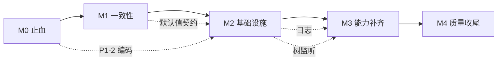

# 修复计划（2026-10-31）

> 依据：《项目全景说明与代码审查报告-2026-10-31》第 8 节（P1/P2/P3）与第 11 节（G1–G18）。
> 范围：**全部问题**，按“先止血、再一致性、再基础设施、再能力、最后质量”的优先级推进，中间设 5 个里程碑。
> 估算前提：1 名熟悉本仓库的开发者；不含证书申请、设计评审与用户验收等待时间。
>
> **执行状态（2026-10-31）**：**M0–M2 已完成**；**M3 基本完成**（G5、G6、G7 跳行/复制/跟随、G8 差异块/历史/分支/冲突/Blame 含行内跟随、G9、G10、G13、G16、G17、交互 P3）；仅剩 G8 分支重命名；**M4 基本完成**（G15 目录/公式/图表、G18 CSV 表格 + JSON 树、N11 无障碍基线、P3 清理已落地）；剩余读屏实测与 N7 签名资产。详见 CHANGELOG 的 `[Unreleased]`。
> **验收清单**：`.doc/验收清单-2026-10-31.md`（C 节可立即验，D–G 节随里程碑勾选）。

## 0. 已确认决策

| 决策项 | 选择 | 对计划的影响 |
| --- | --- | --- |
| 修复范围 | 所有问题，按优先级排序，设里程碑 | P1/P2/P3/G 全部纳入；G11/G12/G14 按下列决定暂缓 |
| P1-2 搜索编码 | 字节预筛 + 按需解码 | UTF-8 走字节快路径；非 UTF-8 检测后解码；带每文件编码缓存 |
| G2 文件树刷新 | 监听“已展开目录” | 只为展开目录建非递归监听，事件到达后只刷新对应层 |
| G3 更新/签名 | updater 骨架 + 占位 | 引入 updater 与“检查更新”入口；endpoint/公钥/证书由后续提供 |
| G11 i18n | 暂不做 | 保持中文 UI，列入 1.x backlog |
| G12 分屏/多窗口 | 暂不做 | 列入 1.x backlog |
| G14 Word 导出 | 暂不处理 | 保持 `.doc（HTML）` 现状，列入 1.x backlog |
| P2-7 死配置 | 接入并清理 | 实现 `lastDirectory`/`rememberExpanded`；删除 `search.*`/`ai.*` |

## 1. 完成定义（Definition of Done）

每个任务必须同时满足：

1. **代码**：实现与现有分层/命名一致，不引入未评估依赖。
2. **测试**：能单测的加单测；不能单测的（UI/监听/打包）在 PR 里附“手动 smoke 步骤”。
3. **回归**：`npm run verify`、`npm test`、`cd src-tauri && cargo test` 全绿。
4. **文档**：更新受影响的 README/报告/帮助文案；破坏性变更写 CHANGELOG。
5. **可观测**：新增失败分支有明确消息或日志，不静默吞异常。

里程碑门禁（Exit Criteria）：

| 里程碑 | 必须达到 |
| --- | --- |
| M0 止血 | P1-1~P1-5 全部关闭；4 个“入口不可用”功能恢复；GBK 搜索可用 |
| M1 一致性 | P2-1~P2-17 全部关闭；前后端默认值契约测试通过 |
| M2 基础设施 | G1/G2/G3/G4 可用；性能项有基线；无新增 P1 |
| M3 能力补齐 | G5–G10、G13、G16、G17 达到可用级（L3） |
| M4 质量收尾 | G15/G18 可用；无障碍与剩余 P3 清理；发布清单完成 |

## 2. 里程碑总览

| 里程碑 | 主题 | 内容 | 工期（人日） | 累计 |
| --- | --- | --- | --- | --- |
| M0 | 止血 | P1 ×5 + 4 个低风险小修 | 2–3 | 第 1 周 |
| M1 | 一致性/正确性 | P2 ×17 + P3 规范/小修 | 6–8 | 第 1–2 周 |
| M2 | 产品基础设施 | G1 正则、G2 树监听、G3 updater、G4 日志 + 性能 | 9–11 | 第 3–4 周 |
| M3 | 能力补齐 | G5–G10、G13、G16、G17 + 交互 P3 | 14–16 | 第 5–7 周 |
| M4 | 质量与差异化 | G15、G18、无障碍、剩余 P3、发布清单 | 8–10 | 第 8–9 周 |

> 总工期约 **7–9 周**（单人串行）。若 M2/M3 内并行两路（前端/后端），可压到 **5–6 周**。

## 3. 任务清单

> 通用约束：凡新增/修改 IPC，必须同步前端类型、报告附录 A 与 capabilities（如涉及权限）；新增命令数变化要在附录 A 更新。

### 3.1 M0 止血（P1 + 低风险小修）

| ID | 对应问题 | 改动要点 | 验收/测试 | 估时 |
| --- | --- | --- | --- | --- |
| M0-1 | P1-1 | 前端改传 `encodingName`；失败回滚下拉值 | 打开 >20MB GBK 日志 → 切 UTF-8 → 行内容立即按 UTF-8 重新解释；切回 GBK 恢复 | 0.5 |
| M0-2 | P1-3/P1-4 | `openStatusMenu` 改为宏任务（`setTimeout 0`）注册 document 点击，并在 `close` 中防重复注册/泄漏；不改各调用点 | 缩进菜单、外部修改菜单点击后保持打开；点空白关闭 | 0.5 |
| M0-3 | P1-5 | 插入图片创建 `<base>.assets` 后 `register_paths([dir, file])`；导出 Markdown 同样登记素材目录 | 单文件 Markdown 插入剪贴板图片成功；导出含图片成功 | 0.5 |
| M0-4 | P1-2 | 搜索/符号定位：ASCII 查询直接字节预筛（跨编码安全）；非 ASCII 先 UTF-8 快路径、失败再按检测编码解码；正则只对非 UTF-8 文件解码；新增每文件编码缓存（mtime+size 失效）；跳过文件计数提示 | 新单测：GBK/GB18030/Big5 中文命中、ASCII 命中 GBK、无效字节跳过；1k 文件基准不明显变慢 | 2 |
| M0-5 | 8.3 规范第 7 条 / 交互第 9、10、1 条 | `editor/keymap.ts` 补 `Mod-Shift-z → redo`（保留 `Mod-y`）；Git 行双击抑制第二次 click；大文件编码下拉过滤 UTF-16；虚拟视图 Ctrl+F 提示“请用视图内过滤” | 手动 smoke：Ctrl+Shift+Z 可重做；Git 行双击不再重复触发 diff（首次单击仍打开 diff）；大文件下拉无 UTF-16；虚拟视图 Ctrl+F 有提示 | 0.5–1 |

**M0 手动 smoke**：打开/保存、GBK 搜索、编码切换、状态栏两个菜单、单文件插图、虚拟视图 Ctrl+F、Git 双击、重做键。

### 3.2 M1 一致性与正确性（P2 + P3 规范）

| ID | 对应问题 | 改动要点 | 验收/测试 | 估时 |
| --- | --- | --- | --- | --- |
| M1-1 | P2-1 | `reveal_in_file_manager` 仅做规范化 + 存在性校验（只读操作不写盘、不登记 PathGuard，避免扩大可写目录），不要求 root | 打开工作区外文件 → “在文件管理器中显示”成功 | 0.5 |
| M1-2 | P2-2 | `quickOpen`/`branchPicker` 改为滑动窗口（DOM ≤200，选中项始终在窗口内，可继续 ↓/↑） | ↓ 越过第 200 条仍有高亮，Enter 打开当前项 | 0.3 |
| M1-3 | P2-3 | 分栏比例收敛为 config 单一真源；删除 localStorage 写入；session 不再存比例 | 设置滑杆、拖动、重启三者一致；改 config 生效 | 0.5 |
| M1-4 | P2-4 | `Notice` 增加 `key`；`addNotice` 按 key 替换而非 kind+text | Vitest：同 key 不同文案只保留最新；不同 key 不合并 | 0.5 |
| M1-5 | P2-5 | diff 行元素构建移入分帧循环；`scrollToHunk` 记录 pending，渲染后跳转 | 5 万行 diff 打开不长时间白屏；跳未渲染 hunk 生效 | 1 |
| M1-6 | P2-6 | 增加 `config-defaults.json` 契约夹具；Rust 与 TS 各自对照夹具测试；修正 `indent` 与 `rust` | 两侧默认值测试同时通过 | 1 |
| M1-7 | P2-7 | 实现 `lastDirectory`（open/save 对话框默认目录）与 `rememberExpanded`（关闭记忆则保存空展开集）；删除 `search.parallelism/chunkSizeBytes`、`ai.*` 及说明项 | 打开/另存默认目录正确；关闭记忆后重启展开态为空；旧配置可正常加载 | 1 |
| M1-8 | P2-8 | 前端 `needVirtualView` 复用后端归一化（小写 + 自动补点） | 配 `LOG`/`log`/`.LOG` 均进入虚拟视图 | 0.3 |
| M1-9 | P2-9 | 虚拟标签的文档统计用 `tab.totalLines`（索引未完成时显示“统计中/—”） | 虚拟视图状态栏与统计不再一个 N 行一个 0 行 | 0.3 |
| M1-10 | P2-10 | `subscribeSettings` 中同步 `setExtraReservedKeys([columnEditorKey])` | 改绑列编辑器键后立即生效，无需重启 | 0.3 |
| M1-11 | P2-11 | `edit.format` 的固定别名从 `Ctrl+Shift+L` 改为 `Ctrl+Alt+Shift+F`，同步菜单/速查/注释 | 速查不再与 CM6 冲突；旧键释放 | 0.3 |
| M1-12 | P2-12 | 后端补 `Windows-1252`；大文件列表补齐；用共用契约夹具锁定“后端 CANDIDATES 去掉 UTF-16”，未知值保留临时 option | 1252 文件下拉显示 1252；三处列表一致 | 1 |
| M1-13 | P2-13/P2-14 | 换行/编码菜单拒绝 `readonly`/`virtual`（与语言菜单一致）；后端/Store 再兜底返回 false | 只读标签改换行/编码不再出现“未保存”死标记 | 0.5 |
| M1-14 | P2-15/P2-16 | 统一虚拟路径拼接（POSIX 用 `/`；Windows 允许 `/`）；导出素材用 `/`；加路径拼接单测 | macOS/Linux 预览图片与导出图片可用；Windows 不回归 | 0.5 |
| M1-15 | P2-17 | `saveSettings` 失败时回滚控件/重渲染设置页，并保留错误消息 | 断网/只读配置目录下，开关不“假装成功” | 0.5 |
| M1-16 | P3 规范 1–4 + 交互 7/8 | `trapFocus` 缩进改回常规；命令标题去掉写死快捷键；`aboutDialog` 版本回退改由 Vite 注入；`openVirtual` 前 `syncContent`；`newUuid` 增加随机兜底（`firstLineError` 全量替换留到 M4-4） | `tsc`/测试通过；关于页版本正确；连续打开虚拟文件不丢未落盘输入 | 1.5 |

**M1 手动 smoke**：快速打开 >200 条、分栏设置/拖动/重启、diff 大文件跳转、只读换行/编码、Mac/Linux 路径（或模拟）、Git 状态刷新。

### 3.3 M2 产品基础设施（G1–G4 + 性能）

| ID | 对应问题 | 改动要点 | 验收/测试 | 估时 |
| --- | --- | --- | --- | --- |
| M2-1 | G1 正则双引擎 | 新增 `regex_test` 与 `preview_replacements` 命令（Rust `regex`）；测试器改走 IPC（150ms 防抖）；搜索替换预览走后端展开（200ms 防抖）；UI 标注“Rust regex，不支持 lookaround/反向引用” | 测试器输入 `(?=x)` 显示清晰错误；`$1`/`${name}` 预览与实际替换一致；`$&` 给出提示 | 2.5 |
| M2-2 | G2 树不刷新 | 新增 `watch_dirs(paths)` 与 `tree://changed` 事件（非递归）；前端维护“已展开目录”集合，变化时重建监听（上限 200，超出提示）；事件 300ms 防抖，只刷新对应目录并触发 Git 刷新；加 `workspace.watchTree` 开关 | 资源管理器新建/删除/改名后 1s 内树更新；折叠目录不监听；200 目录上限有提示 | 2.5 |
| M2-3 | G3 更新/签名 | 引入 `tauri-plugin-updater` + `@tauri-apps/plugin-updater`；capability 加 `updater:default`；`tauri.conf.json` 加 endpoint/公钥占位；菜单/关于页“检查更新…”；未配置时友好提示；补签名/密钥/公证文档 | 开发态点“检查更新”不崩溃且有解释；配置占位后可走到“已是最新/有更新” | 1.5 |
| M2-4 | G4 日志/诊断 | 新增本地滚动日志（`<config>/logs/app.log`，2MB×3）；`panic` hook；`log_event(level, message, context)`；前端未捕获异常/拒绝写入；菜单“打开日志目录/导出诊断”（版本、配置摘要、最近错误） | 制造一次保存失败与一次 panic（测试环境）均有日志；“导出诊断”生成可读 JSON | 2 |
| M2-5 | P3 性能/体验 | 终端 8KB→16ms/32KB 批量；`open_large_file`/`list_drafts` 改 async+`spawn_blocking`；SQL/XML 加 2MB 上限；`probe_file(register:false)` 不登记 PathGuard；`fetch.allowPrivateNetwork` 加设置 UI；Git 网络命令加低速 30s 中止（`loadDocument` 全文比较优化留到 M4-4） | 大文件打开不卡 UI；草稿列表不阻塞；终端高速输出不卡；私网开关可在设置里改 | 3 |
| M2-6 | 文档同步 | 更新 README/用户指南/CHANGELOG；报告补“已修复”标记 | 文档与代码一致 | 0.5 |

**M2 手动 smoke**：正则测试器/预览、资源管理器外部改动、检查更新、日志与诊断、终端高速输出、大文件打开、Git 超时。

### 3.4 M3 能力补齐（G5–G10、G13、G16、G17 + 交互 P3）

| ID | 对应问题 | 改动要点 | 验收/测试 | 估时 |
| --- | --- | --- | --- | --- |
| M3-1 | G5 文件树批量操作 | `selectedEntry` → `Map<path, isDir>` + 锚点；Ctrl/Shift 多选；批量删除/复制/剪切；**指针拖拽**移动（WebView2 下 HTML5 内部 DnD 与原生拖入窗口互斥，故不用 `draggable`，逐项调用 `copy_path` 以便中途失败也能同步标签）；保留单选行为 | 多选删除/移动成功；拖拽到目录生效；撤销/回收站语义不变 | 3 |
| M3-2 | G6 搜索 glob/历史 | 后端 `search_workspace` 增加 `includeGlobs`/`excludeGlobs`（`ignore::overrides`）；搜索面板加两个输入；历史 20 条存 localStorage，可清空 | `src/**/*.ts` 只搜 src；排除 `*.min.js` 生效；历史可复用 | 2 |
| M3-3 | G7 大文件跳行/跟随/复制 | 工具栏加“跳到行”；`follow` 开关（1s 轮询 size，后端 `refresh_large_file` 续扫索引后重载尾窗；手动上滚暂停）；行右键/工具栏“复制当前行”；过滤模式下按可见序号跳转 | 跳到第 10 万行；日志追加时自动跟随；复制行内容正确 | 2 |
| M3-4 | G8 Git 能力 | `git_stage_hunk`/`git_unstage_hunk`（生成 patch + `git apply --cached --check`）；`git_log(limit)`；分支创建/删除/重命名；冲突文件（U）提示“在终端解决”并给命令；`push/pull` 超时/取消 | 单 hunk 暂存/取消；日志列表；新建/删除分支；冲突有明确引导 | 4 |
| M3-5 | G9 终端多会话 | `TerminalState` 改为 `HashMap<id, Session>`；面板加标签页；关闭/重启只影响当前会话；运行命令写入当前会话 | 同时开 PowerShell + cmd；切换/关闭互不影响 | 2 |
| M3-6 | G10 运行 stdin/env | `run_code(path, runner, stdin?)`；设置/运行面板支持 `env` 键值对、超时与输出上限；选区可作为 stdin | 需要输入的程序可运行；环境变量生效；超时可配 | 1.5 |
| M3-7 | G13 编码集/BOM | 扩展候选（Shift_JIS、EUC-KR、Windows-1251 等，按 `encoding_rs` 支持）；状态栏/另存为编码加“带 BOM/无 BOM”选项；单测覆盖 | 日文 Shift-JIS 文件可开；可另存为 UTF-8 BOM | 1.5 |
| M3-8 | G16 工作区设置/最近 | 配置按工作区分区（`workspaces/<hash>.json`，不写用户仓库）；最近工作区列表（欢迎页/菜单）；忽略目录可覆盖 | 两个项目不同缩进/忽略目录；欢迎页可切换最近工作区 | 2 |
| M3-9 | G17 帮助/书签/标签 | 帮助菜单加“用户指南/FAQ”（在线或打包 docs）；侧栏加“书签”列表（跳转/删除）；标签溢出下拉列表 | 能打开帮助；书签列表可用；标签多时可选择 | 1.5 |
| M3-10 | 交互 P3 | 菜单栏键盘导航（↑↓/Home/End/Enter/Esc）；最近文件打开失败自动移除并提示；已删除文件的脏标签把“保存”改为“另存为”；保存成功给轻提示（可关） | 纯键盘可用；失败项不再反复出现；脏标签不重建已删文件 | 1.5 |

### 3.5 M4 质量与差异化（G15、G18、无障碍、剩余项）

| ID | 对应问题 | 改动要点 | 验收/测试 | 估时 |
| --- | --- | --- | --- | --- |
| M4-1 | G15 预览扩展 | 懒加载 `mermaid` + `katex` + markdown-it 插件（锚点/TOC）；预览工具条加“目录”；失败降级为代码块 | mermaid/公式渲染；目录可跳转；禁用时不影响基础预览 | 2.5 |
| M4-2 | G18 结构化视图 | CSV 表格预览（分隔符探测、前 N 行、虚拟滚动）；JSON 树视图（大文件阈值/懒展开）；只读，不改文件 | 10 万行 CSV 可浏览；大 JSON 不卡；只读明确 | 3 |
| M4-3 | 无障碍 | 面板/对话框补 role/aria、焦点顺序、Esc/Tab 行为；快捷键可完成主流程；颜色对比检查 | 键盘走完“打开→搜索→替换→保存”；屏幕阅读器可读主要控件 | 1.5 |
| M4-4 | 剩余 P3/性能 | minimap 扫描移 idle；设置页/帮助文案一致性；`firstLineError` 全量替换；代码围栏/注释清理 | `tsc`/测试绿；无新增 lint/warning | 2 |
| M4-5 | 发布收尾 | 全量回归、CHANGELOG、用户指南、发布检查表（签名/更新/回滚）；报告“已修复”状态更新 | 按清单逐项签字 | 1.5 |

### 3.6 暂缓项（1.x backlog，按决策）

| 项 | 说明 | 建议时点 |
| --- | --- | --- |
| G11 i18n | 中文 UI 保持；后续先做框架 + 高频界面，再补面板 | 1.x |
| G12 分屏/多窗口 | 先评估“编辑器分屏”（同窗口双栏）再考虑多窗口状态隔离 | 1.x |
| G14 Word 导出 | 保持 `.doc（HTML）` 标注；是否引入 docx 待评估包体/保真度 | 1.x |
| G3 证书/公证 | 代码侧骨架先落地；证书、endpoint、公钥需你提供 | 发布前 |

## 4. 测试与回归计划

### 4.1 自动化

- `npm run verify`（tsc + vite build）
- `npm test`（Vitest：notice 去重、默认值契约、路径拼接、键位解析等）
- `cd src-tauri && cargo test`（编码、路径、替换、Git 解析、diff、large、会话、watch、默认值契约、regex_test、hunk patch）

新增测试清单：

| 模块 | 用例 |
| --- | --- |
| 搜索编码 | GBK/Big5/GB18030 中文；ASCII in GBK；无效字节跳过；缓存命中 |
| 配置契约 | Rust 默认值与 TS 默认值对照同一夹具 |
| 正则 | lookaround/反向引用报错；`$1`/`${name}` 展开；`$&` 提示 |
| 树监听 | 临时目录新建/删除/改名事件（如环境稳定）；上限 200 |
| Git patch | hunk patch 校验失败不落地；成功只改 index |
| 路径 | Windows/POSIX 拼接；导出素材相对路径 |

### 4.2 手动 smoke（每个里程碑执行）

1. 打开/保存/另存/另存编码（UTF-8、GBK、UTF-16 BOM）。
2. 状态栏换行/编码/缩进/外部修改菜单。
3. GBK 文件工作区搜索 + F12。
4. 大文件虚拟视图：编码切换、过滤、跳行、跟随、逃生门。
5. 单文件与工作区 Markdown 插图/导出。
6. 快速打开 >200、命令面板、书签、标签溢出。
7. Git：状态/暂存（整文件 + hunk）/提交/分支/拉/推/放弃/冲突提示。
8. 终端多会话 + 运行（含 stdin/env）。
9. 外部修改树刷新（新建/删除/改名）。
10. 更新检查（占位 endpoint）、日志/诊断导出。

## 5. 风险与回滚

| 风险 | 影响 | 缓解/回滚 |
| --- | --- | --- |
| 搜索解码拖慢大仓库 | 搜索变慢 | UTF-8 字节快路径；编码缓存；1k 文件基准；超时可退化为“只搜 UTF-8 + 计数” |
| 树监听句柄/事件过多 | 资源占用 | 只监听展开目录；上限 200；`workspace.watchTree=false` 可关 |
| updater 未签名/endpoint 不通 | 检查更新失败 | 未配置时友好提示；不阻塞启动；功能开关 |
| 日志泄露敏感信息 | 隐私 | 只写本地；不记录文件内容；上限滚动；导出前提示 |
| Git hunk patch 错误 | 改错 index | `git apply --cached --check` 先校验；失败不改动；可回滚 |
| 文件树多选重构 | 交互回归 | 保留单选路径；分步提交；每步 smoke |
| 编码列表扩展 | 检测/映射不一致 | 后端单一来源；前端仅展示；未知值临时 option |
| 分栏比例迁移 | 用户设置丢失 | 一次性迁移 localStorage → config；保留旧值兜底 |

## 6. 依赖关系（简化）

## 7. 执行顺序与交付节奏

1. **第 1 周**：M0 全量 + M1 前半（P2-1/2/3/4/8/9/10/11/12）。
2. **第 2 周**：M1 后半（P2-5/6/7/13/14/15/16/17 + P3 小修），发“0.5.2 止血版”。
3. **第 3–4 周**：M2（G1/G2/G3/G4 + 性能），发“0.6.0 Beta”。
4. **第 5–7 周**：M3（G5–G10/G13/G16/G17），发“0.7.0 RC”。
5. **第 8–9 周**：M4（G15/G18/无障碍/收尾），发“0.8.0 / 1.0 候选”。

每个里程碑结束：跑全量测试 + 手动 smoke + 更新 CHANGELOG；未过门禁不进入下一阶段。

**分支/提交策略**：

| 阶段 | 分支 | 提交粒度 |
| --- | --- | --- |
| M0 | `fix/m0-p1` | 每个 P1 一个 commit；M0-4 可拆 2 个（实现/测试） |
| M1 | `fix/m1-p2` | 按 P2 编号提交；契约/默认值单独一个 commit |
| M2 | `feat/m2-infra` | G1/G2/G3/G4 各自一个 PR，便于单独回滚 |
| M3 | `feat/m3-*` | 每个 G 一个 PR（G5/G8 可再拆） |
| M4 | `feat/m4-*` | G15/G18/无障碍各一个 PR |

每个 PR 必须包含：改动说明、测试命令与结果、手动 smoke 步骤、回滚点。

## 8. 需要你后续提供/确认

1. **G3 上线资产**：Windows 代码签名证书、更新 endpoint、公钥；macOS 公证账号（如发布 macOS）。
2. **格式化别名**：默认改为 `Ctrl+Alt+Shift+F`，如你想保留 `Ctrl+Shift+L` 并接受与 CM6 冲突，请在执行前说。
3. **P2-7 清理**：按“接入 workspace 两项 + 删除 search/ai 字段”执行；如需保留字段请提前说明。
4. **G8 范围**：默认做“hunk 暂存 + log + 分支创建/删除 + 冲突提示”；如只想先做 hunk，可裁剪。
5. **G11/G12/G14**：已确认暂缓，1.x 再评估。

## 9. 首批立即开工（M0）

按顺序：**M0-1 → M0-2 → M0-3 → M0-5 → M0-4**（先小改恢复入口，再做搜索编码，便于中途验证）。
完成后产出：补丁 + 测试结果 + 手动 smoke 记录 + CHANGELOG 条目。
