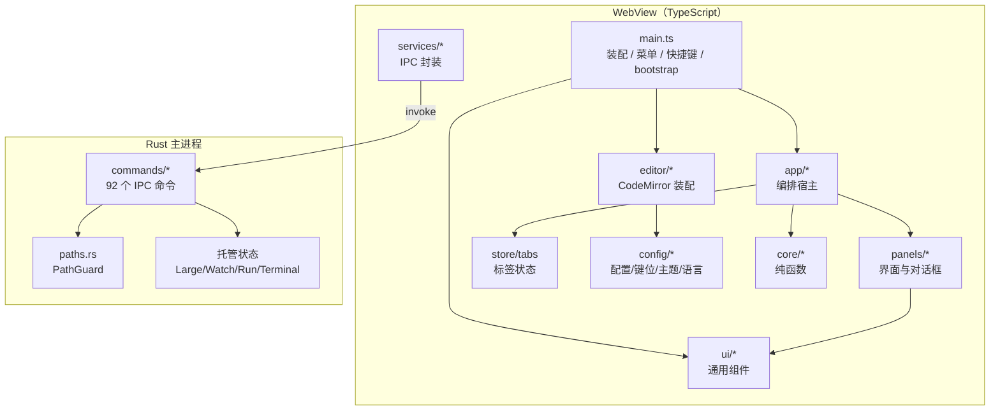

# my-editor 全景说明与代码审查报告

> 生成日期：2026-10-31　|　审查对象：`package.json` 0.5.1 / `Cargo.toml` 0.5.1
> **口径声明**：本文只依据仓库源码（`src/`、`src-tauri/src/`、配置与依赖清单）与依赖库实现反推，**未参考仓库内任何既有文档**。
> 文中 `文件:行` 均为源码定位；结论分「已确认（交叉验证）」与「推断/风险」。P1 = 功能不可用或数据风险，P2 = 边界缺陷/一致性冲突，P3 = 规范/性能/体验。

---

## 0. 结论摘要（先看这里）

**做得好的部分（代码质量主线）**

- 架构分层清晰：`main.ts` 以装配为主（保留少量关闭/保存/重载编排），领域逻辑下沉到 `app/*` 宿主、`panels/*` 视图、`core/*` 纯函数；依赖方向基本清晰（app 不反向依赖 main），但部分列表面板（`fileTree`/`searchView`/`quickOpen`/`largeView` 等）仍直接 `invoke`。
- 高风险路径有系统性防护：原子写、路径作用域守卫（PathGuard）、写入事件自抑制、异步代际令牌（标签切换/语言加载/预览渲染/过滤批次）、大文件体积上限与截断、退出超时兜底。
- 编码链路（BOM → UTF-8 全量校验 → chardetng + 采样回退到字符边界）与换行归一/还原处理相当扎实，并有针对性回归测试。
- 单元测试覆盖面在同类工具里偏上：后端针对编码、路径、替换、Git 解析、diff、large 索引、会话、watch、clipboard 都有测试。

**必须优先修的问题（详见第 8 节）**

| 编号 | 问题 | 影响 |
| --- | --- | --- |
| P1-1 | 大文件视图「切换编码」IPC 参数名不匹配（`encoding` vs `encodingName`） | 该功能 100% 失败 |
| P1-2 | 工作区搜索 / F12 用 `from_utf8_lossy`，不识别编码 | GBK 等中文文件搜不到、符号找不到 |
| P1-3 | 状态栏「缩进」菜单点击即被同一次点击关闭 | 入口不可用 |
| P1-4 | 状态栏「外部修改」三选菜单同样点击即关 | 入口不可用 |
| P1-5 | 未打开工作区时「插入剪贴板图片」必被安全策略拒绝 | 单文件编辑场景功能不可用 |
| P2-1 | 工作区外文件「在文件管理器中显示」被拒并弹「操作失败」 | 只读操作也报错 |
| P2-2 | 快速打开/分支面板 >200 条时键盘选中态丢失 | 大仓库可用性下降 |
| P2-3 | 分栏比例三处真源互相覆盖 | 设置项「不生效」 |
| P2-5 | 差异面板先同步构建全部行 DOM，再分帧 append | 大 diff 仍卡、跳转可能失效 |
| P2-12~16 | 大文件编码下拉缺 1252、只读/虚拟标签可改换行与编码、非 Windows 本地图片/导出路径用反斜杠 | 平台与一致性缺陷 |

**产品成熟度（详见第 11 节）**：**不是玩具，也还不是成熟产品。** 核心编辑 / 编码 / 大文件 / 会话 / 数据安全达 L3–L3+；分发运维与国际化仅 L1–L1.5；主观评分 **6.0 / 10（Beta）**。发布 1.0 前必须先过 M1：5 个 P1 + 正则引擎统一（G1）+ 文件树自动刷新（G2）+ 更新/签名（G3）+ 日志/崩溃报告（G4）。

> **修复进度（2026-10-31）**：M0（P1）、M1（P2）、M2（G1–G4 + 性能）已完成；M3 部分完成（G6、G7 跳行/复制、G8 差异块/历史/分支/冲突/Blame 含行内跟随、G9、G10、G13），G5/G16/G17/G7 跟随/G8 分支重命名待做；M4 未开始。详见 `.doc/修复计划-2026-10-31.md` 与 `CHANGELOG.md` 的 `[Unreleased]`。

---

## 1. 项目介绍（从代码反推）

### 1.1 是什么

`my-editor` 是一个**面向开发者的轻量级桌面文本编辑器**（Tauri 2 + CodeMirror 6），核心能力覆盖：

- 多标签文本编辑（含撤销历史/光标/书签/折叠的会话恢复）；
- 编码检测与转码（UTF-8 / GBK / GB18030 / UTF-16 / Big5 / Windows-1252）、换行符（LF/CRLF/CR）与 BOM 保留；
- 工作区文件树、全局搜索与批量替换（可撤销）、快速打开、大纲、F12 文本级符号定位；
- 大文件只读虚拟视图（稀疏行索引 + 按窗口读取 + 流式过滤）；
- Markdown/HTML 预览与导出（HTML / Word / PDF / Markdown）、图片查看器；
- Code Run（Python/Node/Java/cURL）、内置 PTY 终端、Git 源代码管理面板；
- 格式化（Prettier + 内置 SQL/XML + CLI 工具链）、格式转换（JSON/YAML/Properties/Java）、Cron 解析、正则测试、批量转码、网页抓取。

### 1.2 明确的边界（代码里反复声明的取舍）

| 边界 | 依据 |
| --- | --- |
| 不做 LSP / 语法树级智能 | `search.rs` 注释「文本级，不是 LSP」；`outlineView` 用 `syntaxTree` 节点名启发式 |
| 不做插件系统 / 宏 | `commandPalette.ts` 注释「不含宏录制/回放」 |
| ≥阈值文件默认不进编辑器 | 只读虚拟视图（可在视图内二次确认「以编辑器打开」） |
| 预览固定浅色文档底 | `themeTab.ts` 说明「预览不随主题切换」 |
| 终端/运行非沙箱 | `run.rs` / `terminal.rs` 注释明确「非沙箱」 |
| 单编辑器实例 | `store/tabs.ts` 注释：切标签交换文档，代价是只保留最近 8 份历史 |

### 1.3 代码规模（行数）

前端约 **3.0 万行** TypeScript（145 个文件，29,671 行）+ 4907 行 CSS；Rust 约 **1.0 万行**（23 个文件，10,030 行，含内联单测）。最大的几个文件：`styles/main.css`(4907)、`main.ts`(1818)、`commands/search.rs`(1516)、`commands/git.rs`(1122)、`commands/large.rs`(894)、`panels/fileTree.ts`(886)、`ui/sidebar.ts`(765)、`store/tabs.ts`(735)。

---

## 2. 技术选型

### 2.1 总览

| 层 | 选型 | 在代码中的角色 |
| --- | --- | --- |
| 桌面壳 | **Tauri 2**（Rust） | 窗口/对话框/IPC/单实例/文件关联；`devtools` 特性常开 |
| 编辑器内核 | **CodeMirror 6** | 状态-视图分离、Compartment 热重配、ViewPlugin |
| 前端语言 | **TypeScript 5.x**（`^5.6`，当前安装 5.9.3；`tsc --noEmit` 把关） | 全量类型化 IPC 结构体 |
| 构建 | **Vite 6** + `tsc --noEmit` | 代码分片（语言包/Prettier/预览/终端/差异面板均动态 import） |
| 测试 | **Vitest 5**（前端）+ `cargo test`（后端） | 纯函数与解析器为主 |
| 终端渲染 | **xterm 6** + `addon-fit` | 懒加载面板 |
| 预览 | markdown-it + DOMPurify + highlight.js + turndown(+GFM) | 渲染/消毒/高亮/反向导出 |
| 格式化 | Prettier（standalone）+ sql-formatter + xml-formatter + 外部 CLI | 三通道，懒加载 |
| 编码 | Rust `encoding_rs` + `chardetng` | 检测/解码/编码全在后端 |
| 遍历 | Rust `ignore` | 尊重 `.gitignore`、跳过 ignoreDirs |
| 搜索 | Rust `regex` + `memchr` | 统一正则引擎 + 字面量预筛 |
| Diff | Rust `similar` | 行级 Myers + unified patch |
| 文件监听 | Rust `notify` | 目录级监听 + 自身写入抑制 |
| 抓取 | Rust `reqwest`（rustls） | 跨平台 TLS，无 OpenSSL 依赖 |
| PTY | Rust `portable-pty` | Windows ConPTY / Unix pty |
| 删除 | Rust `trash` | 移入系统回收站 |
| 剪贴板文件 | Windows `windows` crate（CF_HDROP） | 与资源管理器互通 |

### 2.2 关键选型理由（代码注释与实现能印证的）

1. **Rust 承担重 IO 与工作区级解析**：编码检测、全文搜索、diff、大文件索引、会话/草稿落盘、Git CLI 调用都在后端，并通过 `spawn_blocking` 避免阻塞 IPC 线程；前端负责展示/编排与纯文本变换（Prettier/SQL/XML 格式化、格式转换、Cron 等）。这使 20MB 级文件、5000 文件工作区时 UI 仍可交互。
2. **单 CodeMirror 实例 + 每标签状态缓存**：以「换 EditorState」替代「每标签一个编辑器」，内存与 DOM 开销小；用 8 条 / 2MB 上限与「撤销历史已释放」提示管理代价（`stateCache.ts`）——最多保留最近 8 份编辑器状态（含撤销历史）。
3. **Compartment 热重配**：主题、缩进、括号、折叠、minimap、标尺、只读等全部可运行时切换，无需重建编辑器（`extensions.ts`）。
4. **动态 import 分片**：语言包、Prettier 插件、highlight.js 语言、turndown、xterm、diff 面板、设置面板都不进主 bundle；`legacy-modes` 更是「勾选后才可能加载」（虚拟视图与预览宿主是静态引入，不在此列）。
5. **后端白名单化执行**：格式化工具/参数只从 config.json 解析（前端只传语言键），运行器白名单（python/node/java/curl），从根上收窄 RCE 面（`format.rs` 文件头注释）。
6. **PathGuard 纵深防御**：Tauri 2 自定义命令不受 ACL 约束，因此对写/删类命令做作用域校验；读取类保持宽松（必须能打开任意文件）。
7. **零依赖优先**：Cron 解析、缩进检测、键位记法、fuzzy、书签、彩虹括号、列编辑器、minimap 都是自研小模块；引入依赖前评估体积与维护度（例如剪贴板文件列表复用已在依赖图里的 `windows` crate）。

### 2.3 选型的代价（真实存在的）

- **无语法树级智能**：没有补全库、没有跳转定义的类型解析、没有重命名/诊断；F12 是文本启发式，重载/宏/同名不同义会不准。
- **单编辑器实例**：标签很多且文件较大时，撤销历史会被淘汰（有提示但无法避免）。
- **自研 minimap/彩虹括号/书签**：功能可用，但不具备 VS Code 级别的语法着色精度（minimap 为启发式分类）。
- **SQL/XML 格式化在浏览器侧**：超大 SQL 可能造成主线程卡顿（无 Worker；见 `editor/format.ts`）。
- **跨平台分支存在但主战场是 Windows**：文件剪贴板、路径分隔符、`curl.exe`、`taskkill` 等都以 Windows 为先；macOS/Linux 有代码路径但验证痕迹较少（本次审查发现两处反斜杠硬编码，见 P2-15/16）。

---

## 3. 开发与使用说明

### 3.1 环境要求

| 项 | 要求 | 依据 |
| --- | --- | --- |
| Node.js | 支持 Vite 6（建议 ≥ 18/20） | `package.json` devDependencies |
| Rust | **≥ 1.77** | `Cargo.toml` `rust-version = "1.77"` |
| 系统 | Windows 10/11（WebView2）、macOS ≥ 10.15、Linux（WebKitGTK） | `tauri.conf.json` |
| 其他 | 构建 Windows 安装包需要 NSIS / WiX（`bundle.targets: "all"`） | `tauri.conf.json` |

### 3.2 常用命令

```bash
npm install            # 安装前端依赖
npm run dev            # 仅前端（Vite，localhost:5173）——Tauri 环境下一般用下一行
npm run tauri dev      # 启动桌面应用（beforeDevCommand 自动跑 npm run dev）
npm run build          # tsc --noEmit + vite build（类型检查 + 产物）
npm run verify         # 同 build（CI 语义）
npm test               # vitest run（前端单测）
npm run test:watch     # vitest watch
npm run bump           # scripts/bump-version.mjs（版本号同步）
npm run tauri build    # 打包（frontendDist=../dist）
cd src-tauri && cargo test   # 后端单测
```

> 版本号由脚本统一写 5 处：`package.json`、`package-lock.json`、`src-tauri/tauri.conf.json`、`Cargo.toml`、`Cargo.lock`（`npm run bump` 会先内存校验再统一写盘）。

### 3.3 目录结构（开发视角）

```
src/
  main.ts                 装配中枢（DOM 查询、宿主构造、菜单/快捷键、bootstrap）
  app/                    编排宿主（fileService/sessionHost/tabSwitcher/previewHost/
                          largeFileHost/runHost/terminalHost/gitHost/diffService/
                          statusActions/formatHost/symbolHost/layout/windowChrome/
                          dropHost/fetchHost/noticeStore/menuContent/commandTable）
  panels/                 面板与对话框（fileTree/searchView/outlineView/gitView/
                          diffPanel/preview/largeView/settingsPanel/…）
  ui/                     通用组件（statusBar/tabsBar/sidebar/breadcrumb/menu/
                          dialogs/statusMenu/editorMenu/formControls/…）
  editor/                 CodeMirror 装配（setup/extensions/keymap/input/languages/
                          theme/minimap/columnEditor/bookmarks/search/format/…）
  store/tabs.ts           标签状态（唯一可变状态源 + 脏标记指纹）
  config/                 配置类型与默认值、键位解析、用户主题/语言解析
  core/                   纯函数（cron/runOutput/fuzzy/keyNotation/textOps/paths/
                          stamps/messageLog/outlineText…；convert 按需加载 js-yaml）
  services/               IPC 薄封装（session/workspace/fsWatch/launch/userAssets）
  styles/main.css         全部样式（4907 行，未拆分）
src-tauri/
  src/lib.rs              插件 + 92 个命令注册 + 托管状态
  src/commands/*.rs       按域拆分的命令实现
  capabilities/default.json  窗口与对话框权限
  tauri.conf.json         窗口/CSP/打包/文件关联
icons/ scripts/ docs/     （docs 为仓库自带文档，本次审查未参考）
```

### 3.4 运行时数据文件（Tauri 应用配置目录）

| 文件/目录 | 内容 | 维护方 |
| --- | --- | --- |
| `config.json` | 全部用户配置（camelCase），原子写；迁移前备份 `.bak` | `commands/config.rs` |
| `config.json.bak` | 迁移/解析失败时的备份（首次生成时原文件不存在则不产生） | 同上 |
| `session.json` | 打开文件 + 光标 + 滚动 + 书签 + 折叠 + 激活项 + 分栏比例 | `commands/session.rs` |
| `drafts/<fnv>.json` | 未保存内容草稿（含原文件指纹与编码/换行/BOM） | 同上 |
| `workspace.json` | 工作区根 + 展开目录 | `commands/workspace.rs` |
| `replace-history/<id>/` | 批量替换原文快照 + `manifest.json`（可撤销） | `commands/search.rs` |
| `discard-backup/<时间戳>/` | Git「放弃更改」前的文件快照（保留最近 10 批） | `commands/git.rs` |
| `themes/*.json` | 自定义编辑器主题（首次打开目录写示例） | `commands/config.rs` |
| `languages/*.json` | 自定义关键字级语言（首次写示例） | 同上 |
| `startup.json` | 最近一次「进程启动 → 前端就绪」耗时 | `commands/startup.rs` |

另有 `localStorage`：`my-editor.sidebarWidth`、`my-editor.splitRatio`、`my-editor.recentFiles`、`my-editor.palette.recent`。

### 3.5 调试与自检

- 标题栏「🔧」按钮：`plugin:webview|internal_toggle_devtools`（`Cargo.toml` 开启 `devtools`，发布版也可用；权限已由 `core:webview:default` 放行）。
- F12 在应用内被绑定为「转到定义」，**不是**开发者工具（与浏览器习惯不同）。
- 启动耗时：`<配置目录>/startup.json` 的 `processToFrontendReadyMs`。
- 配置自检：命令面板「配置说明」列出字段含义与生效方式；「重新加载配置」后会弹出实际读到的关键值。
- 全局未捕获 Promise 拒绝会弹「操作失败」并可复制详情（`main.ts:1795-1805`）。

### 3.6 打包注意

- `bundle.targets: "all"`：Windows 会同时尝试 NSIS 与 MSI；MSI 依赖 WiX，若 CI 未安装会失败（建议在 CI 里显式指定 `--bundles nsis` 或补齐 WiX）。
- `macOS.signingIdentity: null`：未签名，macOS 首次打开会被 Gatekeeper 拦截（需右键打开）。
- NSIS `installMode: currentUser`：按用户安装，不需要管理员。

---

## 4. 架构与关键机制

### 4.1 进程/模块分层



### 4.2 标签与编辑器状态机

- `tabStore` 是唯一标签状态源；`subscribe(kind)` 区分 `structure`（立即）与 `content`（按帧合并）。
- 脏标记：按键只置 `contentDirty` + `dirty`（O(1)）；800ms 停手后取全文算「长度 + FNV-1a + djb2」指纹与基线比对；编码/换行变化也算脏。
- `TabSwitcher` 用 `loadToken` 代际令牌 + `beginSwitch/endSwitch` 抑制窗口，包住「占位标签载入 → 大文件视图 → loadDocument → 光标/滚动 → 文件树 → 预览」全流程，防止异步回填到错误标签。
- `editor/setup.ts` 用 `docLoadSeq`/`languageSeq` 双令牌，保证「语言包加载完成后文档已切换」时不误配语言。

### 4.3 路径与执行安全（PathGuard）

- `normalize`：词法去 `.`/`..`（越根拒绝）+ 最长存在前缀 canonicalize（解析符号链接）+ 不存在尾段拼回。
- `add_root`：仅目录，用于文件树新建/改名/删除/定位。
- `add_path`：文件或目录，仅作为「已知路径」，**不会**升级为可递归操作的根（有专门回归测试）。
- `ensure_root_scope`：目录树操作；`ensure_file_scope`：写入/运行/导出，额外允许「已知文件同目录」与「已知目录直接子项」。
- 说明：`register_paths` 可被 WebView 内脚本伪造，因此它只能收敛攻击面，真正的封闭依赖 CSP + 预览消毒（代码注释已如实说明）。

### 4.4 编码、换行与只读

- 打开：BOM → UTF-8（前 64KB 采样并回退到字符边界；若采样合法则全量复核）→ chardetng；结果映射到 7 个可展示编码之一，保证 `lookup(display_name)` 闭环。
- 内容：`\r\n`/`\r` 归一为 `\n`（保证撤销回原状能变干净），原风格存 `newline`，保存时按 `newline` 还原。
- 只读：体积 ≥ `largeFileThreshold`（默认 20MB）或扩展名命中 `logExtensions`（默认 `.log`）→ `readonly=true` + 原因。
- 大文件：UTF-16 BOM 直接拒绝虚拟视图（字节级行扫描不成立），回退编辑器。

### 4.5 会话与草稿

- 会话写入：结构变化 400ms 防抖；光标只标脏，15s/页面隐藏/退出时兜底落盘；退出用 `flush()` 等待 IPC 完成。
- 草稿：输入后按 `draftDebounceMs` 防抖写；源文件指纹 = mtime + size + 内容哈希（>4MB 不哈希，且有 64 条指纹缓存）。
- 恢复：`stale` 的草稿另存为「名字（副本）」未命名标签；未命名草稿 key 用 `untitled:<tabId>`，并「先删旧 key 再写新 key」避免新 tab id 复用旧 key 时自杀。

### 4.6 外部修改检测

- Rust 按「已打开文件所在目录」非递归监听；指纹（mtime+size）变化才发 `file://changed`。
- 自身写入用 `writing` 标记 + 写入后指纹抑制；不用时间窗（否则真实外部写入会被吞掉）。
- 前端：后台标签只标 ⟳ + 通知；切到该标签才询问；状态栏提供三选菜单（当前该菜单有 P1-4 缺陷）。

### 4.7 性能保护（代码里明确写的阈值）

| 场景 | 阈值/策略 | 位置 |
| --- | --- | --- |
| 编辑器仅承载 <20MB | `largeFileThreshold` | `file.rs`/`fileService.ts` |
| >5 万行或 >2000 字符长行 | 整篇降级纯文本 | `setup.ts`/`extensions.ts` |
| 撤销历史缓存 | 8 条 / 单文档 2MB | `stateCache.ts` |
| 单词补全 | >2MB 不提供 | `input.ts` |
| 工作区搜索 | 单文件 ≤2MB、200 文件 / 2000 处 | `search.rs`/`searchView.ts` |
| Diff | 单侧 4MB | `diff.rs` |
| 预览 | >20MB 禁用 | `preview.ts` |
| 大文件索引 | 首屏 8MB + 后台补齐、单窗口 4000 行 | `large.rs` |
| 大文件过滤 | 5 万命中上限、可取消、流式批次 | `large.rs` |
| 格式化 | 5s 超时、>1 万行确认 | `format.rs`/`formatHost.ts` |
| Code Run | 30s 超时、1MB 输出 | `run.rs` |
| 抓取 | 10MB / 15s / 10 跳 | `fetch.rs` |
| Minimap | >5 万行桶采样、>20 万行只画视口框 | `minimap.ts` |
| 通知/消息 | 50 条 / 20 条 | `noticeStore.ts`/`messageLog.ts` |

---

## 5. 功能点全说明

> 本节按「用户能做什么」组织，每条给出**入口**（菜单/快捷键/界面位置）、**行为细节**与**限制**。

### 5.1 文件与工作区

| 功能 | 入口 | 行为与限制 |
| --- | --- | --- |
| 打开文件 | `Ctrl+O`；文件树/面包屑/欢迎页；拖放；文件关联；第二实例转发 | 图片走图片查看器；命中大文件阈值/日志扩展名走只读虚拟视图；否则编辑器 |
| 新建未命名文档 | `Ctrl+N`；标签栏 `+`；标签栏空白双击 | 命名 `未命名-N`（自动取最小空闲序号）；`path=null`；草稿 key 用 `untitled:<tabId>` |
| 保存 | `Ctrl+S` | 未命名则转「另存为」；保留编码/换行/BOM；原子替换；失败弹可复制详情 |
| 另存为 | `Ctrl+Shift+S` | 对话框期间标签被关则取消；成功后标签指向新路径 |
| 全部保存 | `Ctrl+Alt+S` | 只存有路径的脏标签；未命名会提示改用另存为；失败列出文件名 |
| 另存为指定编码 | 菜单「文件 ▸ 另存为指定编码…」；状态栏编码菜单底部 | 先选编码再选路径；换行/BOM 沿用当前标签 |
| 重新载入 | `Ctrl+R`；标签右键；状态栏外部修改 | 脏文件先确认；文件不存在时提供「关闭标签 / 保留内容另存」 |
| 关闭标签 | `Ctrl+W`；标签 ×；中键 | 脏且开启 `confirmOnClose` 时三选（保存/不保存/取消）；保存失败不关闭 |
| 批量关闭 | 标签右键：左/右/其他/全部 | 先把所有脏标签落草稿，再统一确认；取消时草稿与现状一致，无害 |
| 重开关闭的标签 | `Ctrl+Shift+T` | 仅磁盘文本，最多 10 条；未命名/虚拟视图/图片不可重开 |
| 标签拖拽排序 | 按住标签横向拖动 | 4px 阈值；插入指示线；松手后 150ms 内抑制误激活 |
| 标签栏滚轮横滚 | 标签栏上滚动 | 仅溢出时接管 |
| 打开目录（工作区） | 侧栏文件夹图标；菜单「文件 ▸ 打开目录」；欢迎页 | 侧栏标题显示目录名，tooltip 显示完整路径；工作区根登记进 PathGuard |
| 文件树 | 侧栏「文件」 | 懒加载；目录单击展开；文件单击/双击打开（可配）；过滤框扁平搜索（200 行上限提示） |
| 文件树右键 | 行右键 | 新建文件/文件夹、与当前文件比较、在终端中打开、复制路径、复制、剪切、粘贴、重命名、删除、在资源管理器中显示、刷新 |
| 文件树键盘 | 焦点在树时 `Ctrl+C/X/V`、`Esc` | 不抢编辑器/输入框的复制粘贴；`Esc` 关闭菜单并清空文件剪贴板 |
| 复制/剪切/粘贴文件 | 上述菜单/键盘 | 复制会写入系统剪贴板（可在资源管理器粘贴）；剪切仅应用内（跨应用剪切等于删工作区外文件）；粘贴优先应用内剪切，其次系统剪贴板；重名复制自动 ` (副本)`/` (副本 N)`；剪切遇同名报错 |
| 删除 | 文件树右键 | 移入系统回收站；删除后干净标签自动关闭，脏标签保留并提示 |
| 重命名 / 移动 | 文件树右键 / 剪切粘贴 | 同步已打开标签路径与文件监听；清空旧路径的展开态缓存 |
| 面包屑 | 编辑区上方路径条 | 点任意段列出「该段所在层」；可上钻/下钻/打开同级文件；工作区外显示盘符/UNC 全路径 |
| 正在打开的文件 | 侧栏「正在打开的文件」 | 激活/关闭/关闭其他/全部/比较/复制路径/在文件管理器中显示；高度按内容自适应（≤50%） |
| 最近打开 | 菜单「文件 ▸ 最近打开…」；欢迎页 | localStorage 20 条；可清空；不校验文件是否仍存在 |
| 窗口拖放 | 拖文件/目录进窗口 | 文件直接打开；目录询问「设为工作区」 |
| 单实例 | 系统层 | 第二次启动把已有窗口拉前并转发文件（避免并发写会话/草稿） |

### 5.2 编辑

| 功能 | 入口 | 说明 |
| --- | --- | --- |
| 行号 / 当前行 / 缩进线 / 括号匹配 | 设置 ▸ 编辑器与布局 | 即时生效（Compartment） |
| 彩虹括号 | 同上 | 6 色按嵌套深度循环；仅扫描视口 ±50 行；跳过字符串/注释/正则；>5 万行禁用 |
| 空白字符显示 | 设置；状态栏「空白」 | 状态栏开关写回配置 |
| 自动换行 | 设置；状态栏「换行」 | 状态栏开关写回配置（300ms 防抖） |
| 列标尺 | 设置（逗号分隔列号，最多 6 条） | 画在 scroller 上，不干扰 contentDOM |
| 代码折叠 | gutter 标记；`Ctrl+Shift+[ / ]`；`Ctrl+Alt+[ / ]` 全部 | 折叠区随会话恢复（行号越界忽略） |
| 自动闭合括号/引号 | 设置开关 | Backspace 成对删除 |
| 输入自动缩进 | 设置开关 | `indentOnInput` |
| 单词补全 | `Ctrl+Space` / `Alt+/`；设置开关 | 只从当前文档取词；>2MB 不提供；刻意不用内置 keymap 以免抢 Enter/Esc/方向键 |
| 多光标 / 列选择 | `Ctrl+点击`；修饰键 + 拖拽（默认 Alt） | 修饰键可配；显示十字光标 |
| 列编辑器 | `Alt+C`；菜单「编辑 ▸ 列编辑器」 | 三种模式：固定文本 / 递增数字（起始/步长/补零）/ 日期（3 格式）；按选区覆盖行插入 |
| 行操作 | 命令面板 / 右键「行操作」 | 升序/降序/数字升序、去重、反转、删空行、删行尾空白、Tab↔空格；有选区取整行，无选区整篇；保留原换行 |
| 大小写/命名风格 | 右键「文本转换」/ 命令面板 | upper/lower/title/camel/Pascal/snake/kebab/CONSTANT；仅选区；保留缩进 |
| JSON 美化/压缩 | 右键「JSON」/ 命令面板 | 有选区处理选区，否则整篇；按当前缩进配置 |
| Markdown 工具 | 右键「Markdown」 | 加粗/斜体/高亮（切换语义）；插入表格（行列对话框） |
| 插入时间/UUID | 右键「插入」/ 命令面板 | 本地时间、ISO、Unix、日期、时间、UUID v4 |
| 插入剪贴板图片 | 右键「插入 ▸ 剪贴板图片」；命令面板 | 存 `<文档名>.assets/image-<时间戳>.<ext>`；MD 插 ``，其他插相对路径；**需工作区或已登记目录（见 P1-5）** |
| 书签 | `Ctrl+F2` 切换；`F2`/`Shift+F2` 循环；gutter ★ | 随会话恢复；RangeSet 随编辑重映射 |
| 撤销/重做 | `Ctrl+Z` / `Ctrl+Y`（Windows；macOS 为 `Cmd+Shift+Z`，Linux 另有 `Ctrl+Shift+Z`） | CM6 `historyKeymap` 的实际绑定；每标签独立，缓存 8 条 / 2MB，超限切回提示一次（菜单显示的 Ctrl+Shift+Z 在 Windows 不生效，见 8.3 节） |
| 智能 Home | `Home` / `Shift+Home` | 第一次到首个非空白，第二次到行首 |
| 删行 / 复制行 / 移动行 | `Ctrl+D`；`Ctrl+Alt+↑/↓`；`Alt+↑/↓` | CM6 内置，固定不可改 |
| 只读保护 | 状态栏「只读 · 原因」 | 大文件/日志/图片；所有写入口统一拦截并提示原因 |

### 5.3 查找、替换、导航

| 功能 | 入口 | 说明 |
| --- | --- | --- |
| 文档内查找 | `Ctrl+F`；右键「查找…」 | CM6 面板（已中文化）；支持区分大小写/正则/全词/In Selection |
| 文档内替换 | `Ctrl+H`；右键（非只读） | 支持 `$1` 捕获组；只读文档退化为仅查找 |
| 查找结果面板 | 菜单「编辑 ▸ 查找结果面板」；右键 | 列表可双击跳转；编辑后防抖重枚举绝对偏移 |
| 工作区搜索 | `Ctrl+Shift+F`；侧栏「搜索」 | 防抖 300ms；大小写/正则/全词（非 ASCII 自动忽略并提示）；按文件分组折叠；上限 200 文件/2000 处；跳过 >2MB 并计数；备份/临时文件会标注「备份」并默认不勾选（后端替换也会拒绝） |
| 批量替换 | 侧栏搜索展开替换行 | 只改勾选文件；脏文件跳过；确认框写明替换数/删除命中/历史/跳过；替换前快照，可撤销；替换后重载标签、刷新文件树与 Git |
| 撤销上次替换 | 搜索结果顶部按钮 | 校验「替换后文件未被再次修改」，否则跳过并说明 |
| 快速打开 | `Ctrl+P` | 多关键词 AND 模糊；路径命中高亮；30s 缓存（5000 文件上限 / 渲染 200 条） |
| 命令面板 | `Ctrl+Shift+P`；标题栏搜索框 | 模糊搜索；最近使用优先；显示快捷键 |
| 大纲 | 侧栏「大纲」 | Markdown 按 `#`；其他语言按 syntaxTree 常见声明节点（500 条上限）；光标跟随；点击跳转 |
| 转到定义 | `F12`；菜单「转到 ▸ 转到定义」 | 文本级；唯一命中直跳，多命中弹菜单（50 条）；无定义回退引用；需工作区；非 UTF-8 文件当前失效（P1-2） |
| 文档统计 | 菜单「视图 ▸ 文档统计…」 | 行/词/字符（不含换行）；虚拟视图会显示 0（见 P2-9） |
| 上一个/下一个标签 | `Ctrl+PageUp` / `Ctrl+PageDown`；标题栏 ← → | 循环切换 |

### 5.4 编码、换行、乱码

| 功能 | 入口 | 说明 |
| --- | --- | --- |
| 编码检测 | 打开文件时自动 | BOM → UTF-8（字符边界采样 + 全量复核）→ chardetng；置信度 bom/high/low/user |
| 重新打开为 | 状态栏「编码」 | 不写盘，按新编码重读；脏文件先确认；手动选择会被记住 |
| 乱码检测 | 打开后自动；命令「检测乱码并建议编码」 | 强信号（合法 UTF-8 却按非 UTF-8 解读）直接建议；否则做无损回编码 + 可读性评分；检测失败与「无乱码」区分 |
| 按文件记忆编码 | 设置 ▸ 文件与会话 | 仅在自动检测置信度 low 时采用；手动「重新打开为」会写入记忆 |
| 换行符切换 | 状态栏「CRLF/LF/CR」 | 仅改内存并标脏，保存时按所选还原；只读/虚拟标签也会标脏（见 P2-13） |
| 保存时清理 | 设置 ▸ 文件与会话 | 删行尾空白 / 补最终换行（默认关；编辑器事务不进撤销栈） |
| 批量另存为编码 | 菜单「工具 ▸ 批量另存为编码…」 | 多选文件 + 输出目录 + 目标编码 + 换行策略；非破坏式；同名跳过；只移除成功项 |

### 5.5 预览与导出

| 功能 | 入口 | 说明 |
| --- | --- | --- |
| Markdown 预览 | 标签栏右侧「编辑/预览/双栏」 | markdown-it(html:false) + DOMPurify + highlight.js；本地图片内联为 data URL；块级 `data-line` |
| HTML 预览 | 同上（.html/.htm） | `iframe srcdoc` + `sandbox=allow-same-origin`（脚本不执行）；iframe 右键转发导出菜单 |
| 双栏联动 | 双栏模式滚动 | 双向 rAF 节流 + 块标记插值 + 120ms 回显抑制；图片加载后重新校准 |
| 预览内查找 | 纯预览模式 `Ctrl+F` | CSS Custom Highlight API（不改 DOM）；不支持时退化为只跳转 |
| 图片查看器 | 打开图片文件 | 适应窗口（不放大超过 100%）、±25% 缩放、1:1；工具条常驻；自然尺寸回报状态栏 |
| 导出 HTML | 预览右键「导出 HTML…」 | 独立文档（内联样式，浅色排版） |
| 导出 Word | 预览右键「导出 Word…」 | HTML-based `.doc`（ProgId=Word.Document） |
| 导出 PDF | 预览右键「导出 PDF…」 | 经系统打印对话框另存 PDF；iframe 60s 后移除 |
| 导出 Markdown | HTML 文件：预览右键/菜单「文件 ▸ 导出 Markdown」 | turndown + GFM；内嵌 `data:image` 落 `.assets` 并改写相对路径；优先微信 `#js_content` 正文 |

### 5.6 大文件只读虚拟视图

| 功能 | 入口 | 说明 |
| --- | --- | --- |
| 自动分流 | 打开 ≥阈值或 `.log` | 8MB 首屏索引 + 后台补齐；状态栏显示行数/编码/换行 |
| 虚拟滚动 | 滚动/点击/拖拽缩略图 | 固定 18px 行高；视口 ±200 行；单次 ≤4000 行；超长行裁到 4000 字符并提示一次 |
| 过滤 | 视图工具条 | 大小写/正则；流式批次先渲染；5 万命中上限；可取消 |
| 缩略图 | 右侧 canvas | 240 桶行密度 + 命中标记；点击跳转 |
| 编码切换 | 视图下拉 | 视图下拉提供 6 种（含 UTF-16）；后端只校验编码名（未强制单字节家族），切到 UTF-16 会因字节级行扫描而错位（见 8.3）；接口参数名当前不匹配（P1-1），下拉缺 1252（P2-12） |
| 自动换行 | 视图工具条 | 会话级偏好；关掉后可横向滚动 |
| 以编辑器打开 | 视图工具条 | ≥阈值二次确认；先读成功再释放会话；<阈值直接转换 |
| UTF-16 | 打开时 | UTF-16 BOM 文件明确拒绝虚拟视图并回退编辑器（BOM-less UTF-16 未被识别，仍可能进入） |

### 5.7 运行与终端

| 功能 | 入口 | 说明 |
| --- | --- | --- |
| 运行当前文件 | `F5`；标题栏「▶ 运行」 | 支持 Python/Node/Java/cURL；脏文件先保存；30s 超时；1MB 输出上限；可停止（Windows 结束整棵进程树，其他平台结束子进程） |
| 输出面板 | 运行后自动展开 | stdout/stderr 分色；去 ANSI；`\r` 折叠；堆栈可点击跳转；cURL JSON 美化；贴底才自动滚动；上限 2000 节点 |
| 在终端运行 | `Ctrl+F5` | 把命令写入现有 shell（PowerShell/POSIX 引号规则由 Rust 处理） |
| 执行 cURL 脚本 | 命令面板；右键「代码」；`runCurlScript` | 选区优先否则整篇；支持 `& 'curl'`、`curl.exe`、反引号续行；无需保存；只读也允许 |
| 内置终端 | `Ctrl+``；标题栏 `>_` | 真实 PTY；懒加载 xterm；重启/关闭/尺寸同步；PowerShell 启动注入 UTF-8 编码 |
| 在终端中打开目录 | 文件树/面包屑/文件行/Git 行右键 | 目录不同会先关旧会话再新开（保证 cwd 一致） |

### 5.8 Git 源代码管理

| 功能 | 入口 | 说明 |
| --- | --- | --- |
| 状态列表 | 侧栏「源代码管理」 | 提交框 + 暂存的更改/更改 两组；条目上限 5000；非仓库显示原因 |
| 暂存/取消 | 行内按钮、组头按钮、右键 | 组头有选中时只作用于选中项；`Shift/Ctrl` 多选；重命名同时传旧/新路径 |
| 提交 | 提交框 `Ctrl+Enter` | 消息 trim 非空；返回 short hash；按钮禁用原因可见 |
| 放弃更改 | 行/组右键；组头「放弃选中」 | 二次确认写明「删除未跟踪文件」；覆盖前快照到 `discard-backup/`（保留 10 批） |
| 查看差异 | 单击行（固定单击） | 工作区 ↔ HEAD / 暂存区 ↔ HEAD；可导出 `.patch` |
| 打开文件 | 双击行（已删除文件禁止） | 从 Git 视图打开工作区外路径时会话恢复等行为一致 |
| 分支切换 | 状态栏分支名；命令「切换分支」 | 面板模糊过滤、当前置顶、ahead/behind 标记；`switch` 失败回退 `checkout` |
| 拉取 | 状态栏 ⟳（同步）或命令 | `pull --ff-only`；无上游给中文提示；分叉如实报错 |
| 推送 | 同上 | `push --porcelain`；拒绝原因回传；无上游给中文提示 |
| 文件树染色 | 自动 | 文件自身状态；目录取子项最高优先级（U>D>M>R>C>A>?） |
| 失败处理 | 自动 | 状态栏首行 + 可复制详情弹窗 + 通知记录 + 「在终端里打开工作区」 |

### 5.9 工具集

| 功能 | 入口 | 说明 |
| --- | --- | --- |
| 格式转换面板 | 菜单「工具 ▸ 格式转换…」；右键 | 源格式自动识别/手动；6 种目标；动态选项；双栏预览；替换/插入新标签/复制 |
| 单步直转 | 命令面板 / 右键「格式转换」 | 先嗅探源格式，不匹配时提示改用面板；>1 万行替换前确认 |
| Cron 解析/生成 | 菜单「工具 ▸ Cron 解析/生成…」 | 5/6/7 段；秒/年可空；预设；反向回填；中文描述；未来 5 次（本地时间，≤2099） |
| 正则测试器 | 菜单「工具 ▸ 正则测试器…」 | g/i/m/s/u；匹配列表 + 捕获组；替换预览；200 条上限 |
| 批量另存为编码 | 见 5.4 | — |
| 网页抓取 | `Ctrl+Shift+U`；菜单「文件 ▸ 从网址抓取网页…」 | URL/目录/文件名（自动建议）；覆盖确认；私网默认拦截；10MB/15s/10 跳；落盘后自动打开 |
| 文档统计 | 见 5.3 | — |
| 格式化文档 | `Shift+Alt+F`（备用 `Ctrl+Shift+L`）；右键 | Prettier / 内置 SQL/XML / CLI；>1 万行确认；失败弹详情；保存时可自动格式化 |
| 格式化选中 | 右键；命令面板 | 先归一化公共缩进，格式化后还原缩进 |

### 5.10 界面与个性化

| 功能 | 入口 | 说明 |
| --- | --- | --- |
| 应用主题 | 设置 ▸ 外观主题 | 深色/浅色/高对比/跟随系统（`data-theme` + CSS 变量） |
| 编辑器主题 | 同上 | one-dark/light/high-contrast/`custom:<名字>`；自定义主题 `themes/*.json`（ui 7 键 + syntax 15 键；坏文件汇总提示） |
| 编辑器字体/字号 | 设置 ▸ 编辑器与布局 | 10–24px；字体族空=等宽栈 |
| Minimap | 设置；`Ctrl+Shift+M` | canvas 密度带 + 视口框；点击/拖拽跳转；主题切换重绘；窄窗口自动隐藏 |
| 状态栏字段 | 设置 ▸ 状态栏字段 | 12 项显隐 + 排序；图片标签自动隐藏无关项；只读原因内联 |
| 侧栏分区布局 | 侧栏标题点击；拖分隔线；↑↓ 微调；双击复位 | 5 分区可多展开；锚点双段布局；手调高度与展开组合写回配置 |
| 侧栏宽度 | 拖 `#sidebar-resizer`；双击复位 | 150–640px，localStorage 记忆 |
| 双栏比例 | 拖分割线；设置滑杆；双击复位 | 15–85%；localStorage + config + session 三源（见 P2-3） |
| 状态栏消息/历史 | 状态栏消息条点击；`查看最近消息` | 3s 消失；最近 20 条可回看；同文案合并时间 |
| 通知中心 | 状态栏 ⚠ | 待处理（外部修改/保存失败/格式化失败/Git 失败）+ 最近消息；可单条忽略/全部清除 |
| 欢迎页 | 无标签时 | 打开文件/新建/打开目录/最近/快捷键/关于 |
| 关于 | 菜单「设置 ▸ 关于…」 | 版本、技术栈、配置目录（可复制/打开） |
| 快捷键速查 | 菜单「设置 ▸ 快捷键速查…」；欢迎页 | 按 section 分组，仅列已绑定项 |
| 配置说明 | 菜单「设置 ▸ 配置说明」 | 字段含义 + 生效方式 + 预留标注 |

### 5.11 会话、草稿、退出

| 功能 | 入口 | 说明 |
| --- | --- | --- |
| 启动恢复 | 自动（`restoreOnStartup`） | 标签顺序、激活项、光标、滚动、书签、折叠、分栏比例；选中项静默载入，其余占位懒加载 |
| 草稿自动保存 | 自动（不可关） | 输入防抖写；内容回基线即删；保存成功即删（窗口内又有输入则重写） |
| 草稿自动恢复 | 启动时 | 原文件未变就地恢复；已变另存「名字（副本）」；结果一条消息 |
| 过期清理 | 启动时 | 草稿按保留天数（0=不清理）；替换历史保留 10 批/7 天 |
| 关闭未保存确认 | 关闭标签/退出 | 可关（`confirmOnClose`）；关掉则直接落草稿关闭 |
| 退出清理 | 关闭窗口 | 停运行进程、关大文件会话、释放终端；2.5s 超时兜底仍关窗 |
| 外部修改提示 | 自动 | 后台标签标 ⟳ + 通知；切到标签才询问；状态栏三选（有 P1-4 缺陷） |
| 保存失败 | 自动 | 弹可复制详情 + 「另存为/从磁盘重新载入」+ 常驻红字 + 通知 |

### 5.12 命令/快捷键/菜单体系

- 菜单栏一级：文件、编辑、选择、转到、视图、比较、工具、设置（`core/commands.ts` 的 `MENU_LABELS`）。
- 命令注册表 `app/commandTable.ts` 同时决定：菜单项、命令面板条目（`hidden` 过滤）、快捷键（`defaultKey`）、键位页（`bindableCommands`）。
- `fixed: true` 的命令只展示不可改（CM6 内置、项目 keymap 绑定如书签/列编辑器/折叠，或系统剪贴板行为）；`altKeys` 为固定别名；`menuShortcut` 只用于菜单展示。
- 快捷键分发在 window 捕获阶段，基于 `e.code` 归一（IME/布局稳定）；模态打开时只阻止 WebView2 默认键。
- 保留键清单：`Mod-Z`、`Mod-Shift-Z`、`Mod-Y`、`Mod-A`、`Mod-C`、`Mod-V`、`Mod-X`、`Mod-/`、`Mod-G`、`Mod-Alt-G`、`Alt-↑/↓`、`F2/F3/Shift-F3/Ctrl-F2` + 动态列编辑器键。
- WebView2 默认键拦截：`Ctrl+S/P/O/N/F/G/R`（避免弹保存网页/打印/刷新）。

### 5.13 命令行、文件关联、单实例

- 文件关联 40 个扩展名（见 `tauri.conf.json`）。
- 冷启动：argv 里的文件入队；热启动：单实例回调入队 + `open-files` 事件；前端 `take_pending_files` 一次取走。
- 相对路径按 cwd 转绝对（「打开方式」启动时 cwd 常是 System32）。

### 5.14 安全与隐私（用户可感知部分）

- 网页抓取默认拒绝内网/本机地址；开关只在 `config.json`（`fetch.allowPrivateNetwork`）。
- Markdown 预览与所有导出统一过 DOMPurify；HTML 预览走 sandbox iframe（不禁用 HTML 结构，但脚本不执行）。
- 删除走回收站；放弃更改/批量替换有本地快照。
- 草稿、会话、替换历史都在应用配置目录，不上传网络；代码中未见遥测/自动上报（只有「从网址抓取网页」会按用户输入主动发起网络请求）。

---

## 6. 配置项参考（`config.json`）

> 完整字段与生效方式也可在应用内「配置说明」查看；这里给出审查后的准确口径。

### 6.1 顶层

| 键 | 类型/默认 | 说明 | 实际接入 |
| --- | --- | --- | --- |
| `version` | `2` | 配置版本（迁移基准） | 是（仅 bump） |
| `theme` | `dark` | dark/light/high-contrast/system | 是 |
| `editorTheme` | `dark` | 内置 3 种或 `custom:<名字>` | 是 |
| `tabSize` | `2` | 缩进宽度 | 是（全局默认） |
| `insertSpaces` | `true` | Tab 插入空格 | 是 |
| `formatOnSave` | `false` | 保存时格式化 | 是 |
| `highlighterDisabledOver` | `50000` | 超行数禁用高亮 | 是（应用语言时） |
| `largeFileThreshold` | `20971520` | 只读/虚拟视图阈值（字节） | 是 |
| `longLineSkipChars` | `2000` | 超长行降级纯文本 | 是 |
| `languageExtensions` | 7 条内置映射 | 扩展名→语言覆盖 | 是 |
| `legacyLanguages` | `[]` | 附加语言开关 | 是 |
| `editorEnhancements` | 见 6.2 | — | 是 |
| `keybindings` | `[]` | 用户键位覆盖 | 是 |
| `layout` | 见 6.3 | — | 是 |
| `session` | 见 6.4 | — | 是 |
| `workspace` | `{rememberExpanded,lastDirectory}` | **未接入**（P2-7） | 否 |
| `largeFile` | 见 6.5 | — | 是 |
| `search` | `{parallelism,chunkSizeBytes}` | **未接入**（P2-7） | 否 |
| `fetch.allowPrivateNetwork` | `false` | 抓取内网 | 是（仅后端读取，无 UI） |
| `terminal.shell` | `""` | 终端 shell（空=自动） | 是（新建终端时） |
| `globalReplace.backup` | `true` | 保留替换历史 | 是 |
| `files` | 见 6.6 | — | 是 |
| `ignoreDirs` | `[node_modules,.git,dist]` | 搜索/快速打开忽略目录 | 是 |
| `fileEncodingMemory` | `{}` | 路径→编码 | 是 |
| `formatters` | 后端 5 个内置工具（前端默认值缺 `rust`，见 P2-6） | CLI 格式化 | 是 |
| `ai` | `{provider,model,enabled}` | **未接入**（P2-7） | 否 |

### 6.2 `editorEnhancements` 默认值

`columnSelection=true`、`columnSelectionModifier="Alt"`、`columnEditorKey="Alt+c"`、`occurrenceHighlight=true`、`showWhitespace=false`、`bracketMatching=true`、`indentGuides=true`、`rainbowBrackets=true`、`wordWrap=false`、`codeFolding=true`、`autoCloseBrackets=true`、`autoIndent=true`、`wordCompletion=true`、`detectIndent=true`、`rulers=[]`。

### 6.3 `layout` 默认值

`sidebarVisible=true`、`sidebarView="files"`、`sidebarExpanded=["files"]`、`sidebarSizes={}`、`splitRatio=0.5`、`defaultViewMode="split"`、`showLineNumbers=true`、`showActiveLine=true`、`minimap=true`、`editorFontSize=14`、`editorFontFamily=""`、`statusBarFields=12 项全显`（后端默认 11 项，见 P2-7）。

### 6.4 `session` 默认值

`restoreOnStartup=true`、`confirmOnClose=true`、`draftDebounceMs=1000`、`draftRetentionDays=7`。

### 6.5 `largeFile` 默认值

`logExtensions=[".log"]`、`sparseIndexAnchorBytes=65536`、`viewportPaddingLines=200`。

### 6.6 `files` 默认值

`openWithDoubleClick=false`、`trimTrailingWhitespaceOnSave=false`、`ensureFinalNewlineOnSave=false`、`encodeMemory=true`。

---

## 7. 命令与快捷键（按命令注册表整理）

### 7.1 默认快捷键

| 快捷键 | 命令 | 备注 |
| --- | --- | --- |
| `Ctrl+N` | 新建未命名文档 | |
| `Ctrl+O` | 打开文件 | |
| `Ctrl+P` | 快速打开 | |
| `Ctrl+S` / `Ctrl+Shift+S` / `Ctrl+Alt+S` | 保存 / 另存为 / 全部保存 | |
| `Ctrl+R` | 重新载入当前文件 | |
| `Ctrl+Shift+T` | 重开关闭的标签 | |
| `Ctrl+W` / `Ctrl+Q` | 关闭标签 / 退出 | 退出项不进命令面板（hidden） |
| `Ctrl+Shift+U` | 从网址抓取 | |
| `Ctrl+,` | 设置中心 | |
| `Shift+Alt+F`、`Ctrl+Shift+L` | 格式化文档 | 后者与 CM6 冲突，见 P2-11 |
| `Ctrl+Alt+D` / `Ctrl+Alt+Shift+D` | 选中下一个/全部相同词 | |
| `Alt+C` | 列编辑器 | 可改绑 |
| `Ctrl+F` / `Ctrl+H` / `Ctrl+Shift+F` | 查找 / 替换 / 工作区搜索 | |
| `F5` / `Ctrl+F5` | 运行 / 在终端运行 | |
| `F12` | 转到定义（文本级） | |
| `Ctrl+F2` / `F2` / `Shift+F2` | 书签切换 / 下一个 / 上一个 | 固定 |
| `Ctrl+Alt+[` / `Ctrl+Alt+]` | 折叠全部 / 展开全部 | CM6 |
| `Ctrl+Shift+P` | 命令面板 | |
| `Ctrl+B` | 切换侧栏 | |
| `Ctrl+Shift+M` | 切换 Minimap | |
| `Ctrl+PageUp` / `Ctrl+PageDown` | 上一个/下一个标签 | |
| `F11` | 全屏 | |
| `Ctrl+Shift+R` | 重新加载界面（先 flush 会话/草稿） | |
| `Ctrl+`` | 终端 | |
| `Ctrl+Space` / `Alt+/` | 触发补全 | 设置开启时 |

### 7.2 内置但仅展示（不可重绑）

`Ctrl+Z`（撤销）、`Ctrl+Y`（重做；Windows 实际绑定，macOS 为 `Cmd+Shift+Z`、Linux 另有 `Ctrl+Shift+Z`）、`Ctrl+A/C/V/X`、`Ctrl+/`（切换注释）、`Ctrl+D`（删行）、`Ctrl+Alt+↑/↓`（复制行）、`Alt+↑/↓`（移动行）、`F3`/`Shift+F3`（查找下一个/上一个）、`Ctrl+G`（下一个命中）、`Ctrl+Alt+G`（跳行）。

> 注：`Ctrl+Alt+G` 由 `@codemirror/search` 的 `searchKeymap` 提供（已核对依赖源码），但未进命令注册表，因此不出现在快捷键速查里。

### 7.3 菜单结构（由注册表派生）

| 菜单 | 条目（按 menuOrder） |
| --- | --- |
| 文件 | 新建 / 打开文件 / 快速打开 / 打开目录 / 最近打开 / 从网址抓取 / 保存 / 全部保存 / 另存为 / 重新载入 / 关闭标签 / 重开关闭的标签 / 退出 |
| 编辑 | 撤销 / 重做 / 剪切 / 复制 / 粘贴 / 查找 / 替换 / 查找结果面板 / 在文件中查找 / 格式化文档 / 格式化选中 / 选中下一个/全部同词 / 折叠全部 / 展开全部 / 列编辑器 / 命令面板 |
| 选择 | 全选 |
| 转到 | 转到定义 / 下一个书签 / 上一个书签（隐藏） |
| 视图 | 切换侧栏 / Minimap / 终端 / 运行输出 / 全屏 / 文档统计 / 最近消息 / 重新加载界面 / 侧栏：打开的文件/源代码管理/文件/搜索/大纲 / 切换分支/拉取/推送 |
| 比较 | 与磁盘内容 / 与文件 / 与 Git HEAD / 与 Git 暂存区 |
| 工具 | Cron / 正则测试器 / 批量编码 / 格式转换 / 检测乱码 |
| 设置 | 设置中心 / 配置说明 / 打开配置文件 / 重新加载配置 / 快捷键速查 / 关于 |

---

## 8. 审查结果：问题清单

> 每条都给出：证据（文件:行）→ 后果 → 修复建议 → 验证方式。
> 「已确认」表示已在源码层面交叉验证（含依赖库实现）；「推断」表示依赖运行环境，未实机验证。

### 8.1 P1（功能不可用 / 数据风险）

#### P1-1 大文件视图「切换编码」必然失败（参数名不匹配）

- **证据**
  - 前端：`src/panels/largeView.ts:524` → `invoke("set_large_encoding", { id: info.id, encoding: next })`
  - 后端：`src-tauri/src/commands/large.rs:736` → `pub fn set_large_encoding(state, id: String, encoding_name: String)`
  - Tauri 2 命令参数默认转 lowerCamelCase（`tauri-macros-2.7.3/src/command/wrapper.rs:51,500-501`：`ArgumentCase::Camel` → `to_lower_camel_case()`），即 JS 必须传 `encodingName`。
- **后果**：大文件/日志视图右上角编码下拉选择后必报 `invalid args ... missing required key encodingName`；因为 `catch` 里只写状态行，下拉还会停在新值，界面与实际解码不一致。
- **修复**：
  ```ts
  await invoke("set_large_encoding", { id: info.id, encodingName: next });
  ```
  失败时把 `encodingSelect.value` 回滚到 `info.encoding`。
- **验证**：打开一个 >20MB 的 GBK 日志 → 切到 UTF-8 → 行内容立即按 UTF-8 重新解释且无错误提示。

#### P1-2 非 UTF-8 文件的工作区搜索 / F12 失效

- **证据**：`src-tauri/src/commands/search.rs:400`、`:976` 都是 `String::from_utf8_lossy(&bytes)`；而 `replace_one`（`:678-680`）做了 `guess + decode_checked`，`file.rs` 打开也做三段式检测。
- **后果**：GBK/GB18030/Big5 文件的中文关键词搜不到（字节变 U+FFFD），F12 找不到符号；ASCII 关键词虽能命中，但命中行前后内容会是乱码；而替换链路按真实编码检测，行为与搜索不一致。这与「编码不乱」的产品定位直接冲突。
- **修复**：为搜索/符号定位复用编码检测：
  ```rust
  let guess = encoding::guess(&bytes);
  let text = encoding::decode(&bytes, &guess.encoding)
      .unwrap_or_else(|_| String::from_utf8_lossy(&bytes).into_owned());
  ```
  建议按文件路径缓存检测结果，避免每次搜索重复猜；检测为 low 置信度的文件可在结果里标注。
- **验证**：GBK 编码的 `.txt` 里写「中文测试」，搜索「中文」应命中，行号/列号正确。

#### P1-3 状态栏「缩进」菜单点击即关

- **证据**：`src/main.ts:191` 的 click 处理器（无 `stopPropagation`）+ `src/ui/statusMenu.ts:113-121` 在点击回调内注册 `document` click 关闭监听。事件仍在冒泡，同一次点击到达 `document` 时新监听器被调用（DOM 在事件到达各节点时才复制监听器列表）。
- **对照**：`statusActions.ts:66-82` 对换行/语言/编码都调用了 `e.stopPropagation()`，所以那三个菜单正常。
- **后果**：状态栏「缩进: 2」点开即消失，用户无法按文档改缩进（只能去设置改全局值）。
- **修复（二选一或都做）**：
  1. 在该 handler 里 `e.stopPropagation()`；
  2. 在 `openStatusMenu` 内延后注册：`queueMicrotask(() => document.addEventListener("click", onDocClick))`（同时保证 `closeStatusMenu` 能移除未注册的句柄）。
- **验证**：点「缩进」→ 菜单保持打开；选「空格 4」→ 当前文档缩进变化，状态栏变「空格:4」。

#### P1-4 状态栏「外部修改」三选菜单点击即关

- **证据**：`src/app/sessionHost.ts:147` 的 click 处理器无 `stopPropagation`，同样与 `statusMenu.ts` 的 document 关闭监听冲突。
- **后果**：「重新载入磁盘内容 / 与磁盘内容比较 / 忽略本次修改」入口不可用。
- **修复**：同 P1-3；或在 `openStatusMenu` 统一兜底（推荐，避免每个调用方都记得加）。
- **验证**：外部程序修改当前文件 → 状态栏「外部修改」→ 点击 → 三项菜单保持打开，选择「忽略本次修改」后状态栏标记消失。

#### P1-5 未打开工作区时「插入剪贴板图片」必被拒（数据路径不可用）

> 严重度介于 P1/P2：功能整体可用（工作区内），但单文件场景必失败。

- **证据**：`src/app/fileService.ts:312-322` 直接 `invoke("write_binary_file", { path: `${dir}/${base}.assets/...` })`；后端 `paths.rs:156-177` 的 `ensure_file_scope` 只允许「已登记根内 / 已登记路径 / 已登记文件同目录 / 已登记目录直接子项」；目标父目录是 `.assets` 子目录，未登记 → 拒绝。
- **对照**：导出 Markdown 的素材目录先在 `previewHost.ts:255-259` 调 `register_paths([folder])`，因此可用。
- **修复**：写前登记：
  ```ts
  await invoke("register_paths", { paths: [assetsDir] });
  ```
  或后端放宽为「已登记文件同目录的下一层子目录」。
- **验证**：不打开工作区，只打开 `D:\tmp\a.md` → 插入剪贴板图片 → 成功生成 `a.assets/image-*.png` 并插入引用。

### 8.2 P2（边界缺陷 / 一致性冲突）

| 编号 | 问题 | 证据 | 后果 | 修复建议 |
| --- | --- | --- | --- | --- |
| P2-1 | 工作区外文件「在文件管理器中显示」报错 | `main.ts:716`、`openEditorsView.ts:126-129`、`fs.rs:316-322` | 只读操作被安全策略拒绝，并以「操作失败」弹窗呈现 | 后端对 reveal 只做 `add_path` 宽松校验（不写盘），或前端捕获并提示 |
| P2-2 | 快速打开/分支面板 >200 条键盘选中态丢失 | `quickOpen.ts:242,280-286`、`branchPicker.ts:193,229-235` | ↓ 越过第 200 条后无高亮，Enter 仍打开正确项 | `selected` 夹紧到 `min(visible.length, 200)-1`，或虚拟滚动 |
| P2-3 | 分栏比例三源互相覆盖 | `layout.ts:158-202`、`statusBar.ts:338-347`、`layoutTab.ts:56-61`、`sessionHost.ts:181-188` | 改 config 的 splitRatio 基本不生效；设置页与拖动结果易「回弹」 | 收敛为单一持久化（建议 config）；session 只存临时态 |
| P2-4 | 通知中心 `dedupeKey` 未生效 | `noticeStore.ts:41-56` | 同一 key 的多条失败/外部修改会堆叠，或按相同文案误合并 | 给 Notice 加 `key`，按 key 去重（保留最新） |
| P2-5 | 差异面板先同步建全部行 DOM | `diffPanel/render.ts:104-140`、`diffPanel.ts:259-267` | 数万行 diff 打开仍卡；目标 hunk 未渲染时跳转无效 | 把构建也放进分帧循环；`scrollToHunk` 记录 pending |
| P2-6 | 前后端默认配置不一致 | `config.rs:105-125,423-461` vs `settings.ts:214-229,311-316` | 状态栏 `indent` 顺序漂移；前端默认缺 `rust`（有兜底） | 抽契约清单 + 跨语言一致性测试 |
| P2-7 | 死配置（声明未读取） | `workspace.rememberExpanded/lastDirectory`、`search.parallelism/chunkSizeBytes`、`ai.*` | `workspace` 两项在「配置说明」里标「即时」但完全无效；`search`/`ai` 标「预留」，与现状一致但仍是空字段 | 接入或删除（至少把 `workspace` 标注改为预留/移除） |
| P2-8 | 日志扩展名前后端口径不一致 | `largeFileHost.ts:58-61`（区分大小写/需带点） vs `file.rs:129-139`（不区分/自动补点） | 配 `LOG` 或 `log` 时进编辑器而非虚拟视图，且只读不可编辑 | 前端复用后端同样的归一化 |
| P2-9 | 文档统计对虚拟视图显示 0 | `commandTable.ts:284-294` + `tabs.snapshotOf` | 状态栏「共 N 行」与统计「0 行」矛盾 | 虚拟标签用 `tab.totalLines`，或提示不支持 |
| P2-10 | 列编辑器键重绑后保留键不刷新 | `main.ts:1542,1683`（只在启动设置）、`keybindingsTab.ts:225-230` | 旧键被永久占用到重启；新键不保留可能被全局命令抢 | `subscribeSettings` 里同步 `setExtraReservedKeys` |
| P2-11 | `Ctrl+Shift+L` 覆盖 CM6「选中全部匹配」 | `commandTable.ts:172` + `@codemirror/search` `searchKeymap` 的 `Mod-Shift-l` | 按 Ctrl+Shift+L 会格式化整篇而非选中匹配 | 换别名（如 `Ctrl+Alt+Shift+F`）或在速查明示 |
| P2-12 | 大文件编码下拉缺 Windows-1252 | `largeView/constants.ts:18` vs `encoding.rs:7-9`、`largeView.ts:140` | 1252 文件下拉显示 UTF-8（与实际解码不符），且无法选回 | 单一来源；未知值补临时 option |
| P2-13 | 只读/虚拟标签可切换换行符 → 脏标记 | `statusActions.ts:87-92`、`tabs.ts:682-691` | 出现「● 未保存」，而保存被只读拦截；只能改回原值或重开，且提示还引导用户 Ctrl+S | 拒绝 virtual/readonly，或 `setNewline` 返回 false |
| P2-14 | 状态栏编码菜单在虚拟视图上误导 | `statusActions.ts:158-197`、`tabs.ts:694-713` | 状态栏编码变了、内容仍按旧编码解码，且可能标脏 | 拒绝 `tab.virtual`（与语言菜单一致） |
| P2-15 | Markdown 本地图片内联在非 Windows 失效 | `preview/localImages.ts:63/67/69/75/81` | macOS/Linux 预览与导出丢本地图片 | 统一路径拼接（用 `/` 或平台分隔符） |
| P2-16 | 导出 Markdown 素材目录用反斜杠 | `previewHost.ts:281` | 非 Windows 生成怪文件名，Markdown 引用失效 | 同上 |
| P2-17 | `saveSettings` 失败时 UI 与内存配置不一致 | `settings/shared.ts:54-61`、各 `checkRow` 先改视觉 | 写盘失败只弹一条消息，控件仍显示新值 | 失败时重渲染当前分类（回滚视觉） |

### 8.3 P3（规范 / 性能 / 体验）

**规范与一致性**

1. `src/ui/dialogs.ts` 5 处 `trapFocus(dialog);` 顶格（83/139/227/289/357 行），与文件缩进风格不一致（无功能影响）。
2. `edit.foldAll`/`edit.unfoldAll`/`edit.complete` 的 `title` 内写死快捷键（`commandTable.ts:178-180`），键位改了标题不变；与其它条目的命名习惯不一致。
3. 首行错误提取 `String(e).split("\n")[0]` 在仓库内重复 50+ 次（本次统计 57 处；`gitHost`/`formatHost`/`fileService`/`sessionHost`/各面板），建议抽 `firstLineError(e)`。
4. `aboutDialog.ts:21` 版本回退值是 `"0.1.0"`，与当前 0.5.1 不符（仅 getVersion 失败时可见）。
5. `ui/menubar.ts` 无键盘导航（只有点击/悬停），与 `ui/menu.ts` 的 ↑↓/Home/End/Enter 支持不一致。
6. 仓库同时存在 `docs/` 与 `.doc/` 两套文档目录（本次审查按要求未引用其中内容）；建议明确单一事实源（代码 + 本报告），避免文档与实现各自演化。
7. **重做键位显示与 Windows 实际绑定不一致**：`commandTable.ts:309` 把 `edit.redo` 标为 `Mod-Shift-Z`（菜单/快捷键速查显示 `Ctrl+Shift+Z`），`app/menuContent.ts:93` 也硬编码 `Ctrl+Shift+Z`；但 CM6 `historyKeymap` 在 Windows 只绑定 `Mod-y`（`@codemirror/commands` 中 `mac: Mod-Shift-z`、另有 `linux: Ctrl-Shift-z`）。Windows 上按 `Ctrl+Shift+Z` 无任何反应（该键在保留集里，全局分发也不会接管）。建议在 `editor/keymap.ts` 补 `{ key: "Mod-Shift-z", run: redo }`（并保留 `Mod-y`），或让展示按平台解析。

**性能 / 资源**

1. `editor/setup.loadDocument` 缓存快速路径用 `cached.state.doc.toString() === content` 做全文比较（`setup.ts:322-337`）——同标签重复载入时 O(n) 全文构造；建议用长度 + 指纹或 `docId + 版本` 标记。
2. `terminal.rs:372-390` 每 8KB 发一个 base64 事件，高速输出会产生事件风暴；建议 16–64KB 批量或前端按帧合并。
3. `large.rs::open_large_file` 在命令线程同步扫 8MB；`session.rs::list_drafts` 同步遍历草稿并 fingerprint 原文件（最多每个 4MB）——启动/打开大文件时有主线程阻塞风险，建议改 `async + spawn_blocking`。
4. `minimap.ts` 文档变更后 150ms 重建，≤5 万行全量扫描、≤2 万行逐行分类；大文档连续输入仍有可感知开销（已有降级，属可接受，但可把扫描移到 idle 回调）。
5. `editor/format.ts` 的 SQL/XML 格式化在主线程执行，超大 SQL 会卡 UI（建议 Worker 或上限）。
6. `preview/localImages.ts` 的 `probe_file` 会把预览里出现过的图片路径登记进 PathGuard（读取类宽松，无安全影响，但作用域集合随预览增长）。

**交互/人性化**

1. 虚拟视图下 `Ctrl+F` 打开的是编辑器查找面板，但编辑器被隐藏（`commandTable.ts:248-254`）；建议提示「请用视图内过滤」。
2. 保存成功不弹消息（只靠脏标记消失与状态栏大小变化），首次使用可能不确定是否保存成功。
3. `recentFiles` 不校验文件是否仍存在，点击已删除文件只得到「打开失败」。
4. `fetch.allowPrivateNetwork` 无设置 UI，只能改 config.json（错误提示里有引导）。
5. Git 失败时状态栏 8s + 弹窗 + 通知三处提示，信息分层不冗余（可接受）；但 `push/pull` 没有超时与取消，网络卡住时串行队列会一直占住（后续 Git 操作排队）。
6. `fileTree` 删除文件后，脏标签保留并提示「可用另存为」，但用户直接 Ctrl+S 会把文件重新创建（注释已承认这一取舍）；建议脏标签删除后把「保存」临时改为「另存为」。
7. `tabStore.openVirtual` 替换同路径普通标签前没有 `syncContent(activeId)`（`tabs.ts:246-269`），极端情况下会丢掉尚未落回标签的输入。
8. `newUuid` 对 `crypto` 完全缺失无兜底（`stamps.ts:29-33`）。
9. 源代码管理行「双击打开文件」会先触发单击的 diff（实际上是两次 click）：`bindOpenGesture(forceSingleClick)` 绑定了 click → diff，`dblclick` 又单独绑了打开文件，双击时两个动作都会发生（`gitView.ts:419-427`）。建议在 dblclick 里抑制单击动作（如结合 `e.detail`）或去掉双击打开。
10. 大文件视图编码下拉包含 UTF-16 LE/BE（`largeView/constants.ts:18`），但虚拟视图是字节级行扫描 + 逐行解码；`set_large_encoding` 只校验编码名（`large.rs:736-748`），切到 UTF-16 会导致行错位/乱码。建议下拉过滤 UTF-16，或后端拒绝非单字节编码。

---

## 9. 交叉验证通过项（不是问题，避免误报）

1. **IPC 参数名**：对 92 个后端命令与前端全部 `invoke` 调用点逐一对照（参数名与数量），除已修复的 `set_large_encoding` 外全部匹配（camelCase ↔ snake_case，依据 `tauri-macros` 的 `ArgumentCase::Camel`）。
2. **事件名**：`file://changed`、`tree://changed`、`run://chunk`、`run://exit`、`terminal://output`、`terminal://exit`、`large://index-progress`、`large://index-ready`、`large://filter-progress`、`large://filter-batch`、`open-files` 前后端一致。
3. **结构体字段**：`FileContent`/`SaveResult`/`SearchReport`/`ReplaceReport`/`UndoReport`/`GitStatus`/`GitFileEntry.orig_relative`/`ImageFile.data_url` 为 snake_case（Rust 未加 `rename_all`），前端类型一致；`FileProbe`/`DiffPayload`/`MojibakeReport`/`LargeFileInfo`/`LineWindow`/`FilterBatch`/`DraftInfo`/`TerminalInfo`/`FetchResult`/`DiscardOutcome`/`BatchReport` 为 camelCase，前端一致。
4. **配置结构**：`AppConfig` 及所有子段字段名前后端一致，`version=2` 一致。
5. **DevTools 权限**：`gen/schemas/acl-manifests.json` 中 `core:webview.default_permission` 含 `allow-internal-toggle-devtools`，`core:default` 含 `core:webview:default` → 标题栏「调试」按钮可用。
6. **CM6 键位优先级**：`c.keymap`（`Mod-d` 删行）在 `searchExtensions()` 之前，`Mod-d` 不会被 `selectNextOccurrence` 抢；`Mod-Alt-g`（goToLine）在保留键中，全局分发器不抢。
7. **草稿键顺序**：`autoRestoreDrafts` 先删旧 key 再写新 key（`sessionHost.ts:515-519`），规避新 tab id 复用旧 key 的自杀。
8. **空 path 归一**：`write_draft` 把空串归一为 `None`，`is_stale` 对 `Some("")` 也按无关联文件处理（`session.rs:178-182,340-344`）。
9. **UTF-8 采样边界**：`encoding.rs:72-89` 回退到字符边界 + 全量复核，并有回归测试。
10. **原子写**：临时文件 → `sync_all` → rename（失败重试 1 次）→ 失败清理临时文件（`file.rs:270-298`）。
11. **自身写盘抑制**：`mark_writing/note_written` 包裹保存与批量替换，失败也调用 `note_written`（`file.rs:348-361`、`search.rs:584-586`）。
12. **大文件锚点不变式**：锚点只落在换行符之后（行首），有单测 `anchors_always_land_on_line_start`。
13. **单实例**：第二实例拉前窗口并转发 argv 文件（`lib.rs:20-34`），避免并发写 session/drafts。
14. **退出兜底**：清理 2.5s 超时后仍 `destroy`，capabilities 已放行 `allow-destroy`（`windowChrome.ts:174-189`）。
15. **格式化 RCE 面**：工具/参数只从后端 config 解析，且拒绝 `-o/--in-place/--config` 等参数（`format.rs:34-43,53-76`）。
16. **抓取 SSRF 防护**：scheme 白名单、拒绝 userinfo、私网/本机/CGNAT/链路本地拦截，开关由后端读配置（`fetch.rs:51-128,240-241`）。

---

## 10. 建议的修复顺序（按投入产出比）

> 可执行版见 `.doc/修复计划-2026-10-31.md`（含 M0–M4 里程碑、逐任务改动点、测试与风险）；下表是“先做什么”的摘要。

| 顺序 | 内容 | 预估工作量 | 收益 |
| --- | --- | --- | --- |
| 1 | P1-1 参数名 + P1-3/P1-4 菜单冒泡（3 处小改） | 0.5 天 | 修好 3 个「点了没反应/一闪就没」的硬伤 |
| 2 | P1-5 图片素材目录登记 + P2-1 reveal 放宽 | 0.5 天 | 单文件场景可正常插图/定位 |
| 3 | P1-2 搜索/符号定位接入编码检测（含缓存） | 1–2 天 | 中文旧文件可用，产品定位自洽 |
| 4 | P2-13/14 只读/虚拟标签的状态栏入口收敛 | 0.5 天 | 消除永久脏标记与错误提示 |
| 5 | P2-2 选中态夹紧、P2-5 diff 分帧与跳转 | 1 天 | 大仓库/大 diff 可用性 |
| 6 | P2-3 分栏比例单一来源 + P2-7 死配置清理/接入 | 1 天 | 设置项不再「假装生效」 |
| 7 | P2-8/P2-12 编码与日志扩展名单一来源 | 0.5 天 | 前后端口径一致 |
| 8 | P2-15/16 跨平台路径 | 0.5 天 | macOS/Linux 可用 |
| 9 | P2-6 默认值契约测试、P2-10 保留键刷新、P2-11 键位冲突 | 1 天 | 防止回归与键位「玄学」 |
| 10 | P3 性能项（终端批量、草稿列表异步、SQL Worker） | 2–3 天 | 大文件/大数据量体验 |

---

## 11. 功能完备度评估（产品视角）

> 本节不是「功能清单」而是「能不能当产品用」的判断。标准：**主流程能闭环、边界/空态/异常有交代、入口可发现、失败可恢复、性能有上限、跨平台一致、有回归测试**；功能数量不等于产品成熟度。未跑 UI，结论基于代码路径与错误分支覆盖。

### 11.1 成熟度分级口径

| 等级 | 定义 | 判定要点 |
| --- | --- | --- |
| L4 产品级 | 主流程 + 边界 + 异常 + 空态 + 可发现性 + 可恢复性 + 性能上限 + 跨平台 + 回归测试 | 用户不看文档也能完成；出错有出路 |
| L3 可用级 | 主流程闭环，边界有提示，缺增强项 | 日常能用，偶发“得绕一下” |
| L2 半成品 | 入口存在但功能不完整 / 有条件不可用 / 体验断裂 | 用户会认为“这是没做完” |
| L1 演示级 | 只覆盖 happy path，无持久化/无错误处理 | 玩具 |

### 11.2 分域成熟度

| 域 | 现状 | 判定 | 产品级缺口 |
| --- | --- | --- | --- |
| 文件与工作区 | 打开/保存/另存/另存编码、文件树、面包屑、快速打开、最近打开、拖放、单实例 | **L2（接近 L3）** | 文件树不监听外部变化；单文件剪贴板、无多选/拖拽移动；工作区外 reveal/插图被安全策略拒绝（P2-1/P1-5） |
| 编辑 | 多标签、撤销/重做、多光标/列选择、列编辑器、折叠、书签、minimap、自动闭合/缩进/补全、行操作、大小写、JSON/Markdown 工具 | **L3** | 无 LSP/诊断/重命名（定位如此）；无宏/脚本；补全仅文档内取词 |
| 搜索与替换 | 文档查找替换、结果面板、工作区搜索、批量替换+撤销、快速打开 | **L2** | 非 UTF-8 文件搜不到（P1-2）；正则引擎与测试器/预览双轨（G1）；无 include/exclude glob、无搜索历史（G6）；无 hunk/选区级替换 |
| 编码与换行 | 三段式检测、7 候选编码、重新打开为、乱码诊断、按文件记忆、批量转码、EOL 保留 | **L3** | 搜索链路不识别编码（P1-2）；编码集仅 7 种（无 Shift-JIS/EUC-KR 等，G13）；无 BOM 开关（只能沿用，G13） |
| 预览与导出 | Markdown/HTML 预览、三模式、双栏联动、预览内查找、图片查看、导出 HTML/Word/PDF/Markdown | **L3** | 无 Mermaid/数学公式/目录（G15）；Word 为 HTML .doc、PDF 走打印（无页眉页脚/分页控制，G14） |
| 大文件 | 稀疏索引、窗口读取、流式过滤、缩略图、编码切换、逃生门 | **L3** | 编码切换接口损坏（P1-1）；可切 UTF-16 但会错位（见 8.3 交互第 10 条）；无跳行/跟随（tail -f）、无复制行（G7） |
| 运行 | Python/Node/Java/cURL、流式输出、停止、堆栈跳转、JSON 美化 | **L3** | 无 stdin、无自定义 env、超时/输出上限不可配（G10）；只支持 4 种运行器（定位如此） |
| 终端 | 真实 PTY、UTF-8、在终端运行、重启/关闭、尺寸同步 | **L2.5** | 单会话（G9）；无多标签/分屏/Profile；无链接识别（由 xterm 决定） |
| Git | 状态/暂存/提交/分支/拉取/推送/放弃+备份/基础 diff | **L2.5** | 无 hunk 级暂存、无 log/blame/stash、无分支创建删除、无冲突引导（G8）；网络命令无超时/取消 |
| 工具集 | 格式转换、Cron、正则测试、批量编码、网页抓取、统计 | **L3** | 正则测试器与搜索引擎不一致（G1）；Cron 不支持 L/W/#（文档已注明）；Java 解析为启发式；SQL 格式化无方言选择 |
| 设置与主题 | 集中设置、即时生效、自定义编辑器主题/语言、快捷键自定义、状态栏字段 | **L3** | 无 per-workspace 设置、无导入导出/单页重置（G16）；死配置与默认值漂移（P2-6/P2-7） |
| 会话与草稿 | session.json、草稿、自动恢复、退出兜底、外部修改 | **L3+（数据安全亮点）** | 无崩溃报告；无磁盘自动保存选项（设计取舍）；图片标签不恢复 |
| 命令与快捷键 | 单一注册表、菜单/面板/速查同源、冲突检测、模态保护、保留键 | **L3** | 重做显示 Ctrl+Shift+Z 但 Windows 未绑定（见 8.3 规范第 7 条）；无 chord 序列（两段式快捷键） |
| 分发与运维 | NSIS/MSI、文件关联、单实例 | **L1** | 无自动更新、无代码签名（Windows SmartScreen / macOS Gatekeeper）、无日志/崩溃报告、无便携版（G3/G4） |
| 国际化与无障碍 | 中英 README、部分 aria/焦点陷阱 | **L1.5** | UI 中文硬编码、无 i18n；大量面板无 role/aria；未验证高对比与屏幕阅读器（G11） |

### 11.3 产品视角新缺口（G 列表，建议级别）

> 这些是“当产品要求”才会暴露的缺口，与第 8 节的 P 编号不重复；G1–G8 建议按 P2 处理，其余 P3。

| 编号 | 缺口 | 证据 | 用户感受 |
| --- | --- | --- | --- |
| G1 | 正则引擎双轨：测试器/替换预览用 JS `RegExp`，搜索/替换用 Rust `regex` | `regexTester.ts:156`、`searchView.ts:450` vs `search.rs:352/560` | 测试器里能匹配的 lookahead/反向引用，搜索里报“正则无效”；`$&` 预览与实际替换不一致 |
| G2 | 文件树不监听外部变化 | `watch_files` 只由 `sessionHost.ts:552/564` 调用；`fileTree.ts` 无 `file://changed` 订阅 | 在资源管理器新建/删除/改名后，树还是旧的，只能手动刷新 |
| G3 | 无自动更新/代码签名/便携版 | `Cargo.toml` 无 `tauri-plugin-updater`；`tauri.conf.json` 无 Windows 签名配置、macOS `signingIdentity: null`、`targets: "all"` | 每次升级靠手动下载；首次安装被 SmartScreen/Gatekeeper 拦 |
| G4 | 无日志/诊断/崩溃报告 | 无 `log`/`tracing` 依赖；只有 `startup.json`、`eprintln!`、`console` | 用户报障只能描述现象，开发者无法定位 |
| G5 | 文件树单文件操作 | `fileTree.ts:84` 单个 `selectedEntry`；无 `draggable`、无多选 | 批量删除/移动要一个个来；不能拖拽整理目录 |
| G6 | 搜索无 include/exclude glob、无搜索历史 | `search_workspace(root, query, …, ignoreDirs, maxFiles, maxMatches)` 无 glob 参数；`searchView.ts` 无历史存储 | 大仓库只能靠 ignoreDirs，不能“只在 src/**/*.ts 里搜” |
| G7 | 大文件视图无跳行/跟随/复制行 | `largeView/dom.ts` 只有过滤/编码/换行/去编辑器按钮 | 看日志想跳到第 N 行/Tail 跟随，只能滚或过滤 |
| G8 | Git 无 hunk 暂存、log/blame、分支管理、冲突引导 | `git.rs` 命令仅 status/stage/unstage/commit/branches/checkout/pull/push/discard；`git_stage` 只收 paths | 只能整文件暂存；冲突时只能去终端 |
| G9 | 终端单会话 | `terminal.rs:69` `slot: Arc<Mutex<Option<Session>>>` | 不能同时开前端/后端两个终端 |
| G10 | 运行无 stdin/env，超时与输出上限写死 | `run.rs:496` `stdin(Stdio::null())`；超时/上限为常量 | 需要输入的程序跑不了；长任务 30s 必断 |
| G11 | 无 i18n，UI 中文硬编码 | 无 i18n 依赖；界面文案全部为中文字面量 | 英文用户无法使用（README.en 与 UI 不匹配） |
| G12 | 无多窗口/编辑器分屏 | 无 `WebviewWindowBuilder`；`split` 仅用于预览双栏 | 不能并排看两个文件，也不能开第二个窗口 |
| G13 | 编码集仅 7 种、无 BOM 开关 | `encoding.rs:7-9`；`saveEncoding.ts` 无 BOM 选项；`has_bom` 只沿用 | 日韩/俄文文件无法正确打开；不能把文件转成“UTF-8 with BOM” |
| G14 | 导出保真度 | Word 为 HTML `.doc`（`preview/export.ts:84`）；PDF 走 `window.print()` | Word 排版在复杂文档下会走样；PDF 不能控制页眉页脚/分页 |
| G15 | 预览缺 Mermaid/数学公式/目录 | `markdownPipeline.ts` 仅 markdown-it + highlight.js，无相关插件 | 技术文档里的 mermaid/公式显示为代码块 |
| G16 | 无 per-workspace 设置、无最近工作区 | 配置全局；`workspace.json` 只存单个 root；`workspace.lastDirectory` 未使用 | 不同项目不能有不同缩进/忽略目录；换项目要重新选目录 |
| G17 | 无帮助文档入口、书签列表、标签溢出列表 | 帮助类入口只有配置说明/快捷键/关于，无 docs/手册链接；`bookmarks.ts` 只有 gutter/跳转；`tabsBar.ts` 只有滚动/拖拽，无溢出列表 | 新用户不知道 docs 存在；书签多了只能 F2 逐个跳；标签多了只能滚 |
| G18 | 无 CSV/JSON 结构化视图 | `preview/pathKind.ts` 只识别 md/html | CSV/JSON 只能当文本看，不能表格/树形浏览 |

### 11.4 已经达到产品级的部分（不是玩具的证据）

1. **数据安全链路**：原子写（临时文件→fsync→rename）、删除走回收站、替换历史快照、Git 放弃改动备份、草稿/会话双保险（`file.rs`/`fs.rs`/`search.rs`/`git.rs`/`session.rs`）。
2. **编码正确性**：BOM→UTF-8 全量校验→chardetng，且处理了 64KB 采样边界；EOL 归一/还原；乱码诊断有“强信号 + 无损回编码评分”两级（`encoding.rs`/`file.rs`）。
3. **大文件能力**：稀疏索引 + 窗口读取 + 流式过滤 + 缩略图 + 逃生门，属于同类轻量编辑器里的差异化能力（`large.rs`/`largeView`）。
4. **会话/草稿体验**：标签顺序、光标、滚动、书签、折叠全恢复；关闭/退出前落草稿；退出清理有 2.5s 超时兜底（`sessionHost.ts`/`windowChrome.ts`）。
5. **错误反馈**：保存/格式化/Git 失败都有“可复制详情 + 下一步动作 + 通知中心记录”，不是只弹一句“失败”（`dialogs.ts`/`gitHost.ts`/`main.ts`）。
6. **命令/快捷键架构**：菜单、命令面板、快捷键、速查、设置键位页同源，避免漂移；模态期间屏蔽全局快捷键并有焦点恢复（`core/commands.ts`/`config/keybindings.ts`/`main.ts`）。
7. **安全基线**：PathGuard 作用域、格式化工具白名单、抓取私网拦截、预览 sandbox/消毒、CSP（`paths.rs`/`format.rs`/`fetch.rs`/`preview.ts`/`tauri.conf.json`）。
8. **工程纪律**：重活 `spawn_blocking`、子进程 `no_console`、体积/行数/命中上限与截断提示、依赖动态分片。

### 11.5 产品级 DoD 清单（当前状态）

| 必须项 | 状态 |
| --- | --- |
| 打开/保存原子性、失败有出路 | ✔ |
| 编码/换行/BOM 不丢 | ✔（BOM 只保留，不能编辑） |
| 非 UTF-8 文件可搜索/符号定位 | ✘（P1-2） |
| 大文件可查看/过滤，编码可切换 | ✘（P1-1 / 8.3-10） |
| 会话恢复 + 未保存草稿 | ✔ |
| 外部修改提示与处理 | △（菜单有 P1-4 缺陷，通知中心可用） |
| 文件树随外部变化刷新 | ✘（G2） |
| 批量文件操作（多选/拖拽） | ✘（G5） |
| 搜索 include/exclude + 历史 | ✘（G6） |
| 正则引擎端到端一致 | ✘（G1） |
| Git 基本流（状态/暂存/提交/拉/推/放弃） | ✔ |
| Git hunk/冲突/历史 | ✘（G8） |
| 终端多会话 | ✘（G9） |
| 运行 stdin/env/可配超时 | ✘（G10） |
| 主题/字体/布局/快捷键自定义 | ✔ |
| 自动更新/签名/日志/崩溃报告 | ✘（G3/G4） |
| i18n/无障碍 | ✘（G11） |
| 帮助入口（docs/手册） | △（有内置配置说明/快捷键，无 docs 入口） |
| 多窗口/编辑器分屏 | ✘（G12） |

### 11.6 结论（能不能当产品）

**不是玩具，但还不是成熟产品。**

- 作为「个人/小团队的本地文本与日志编辑器」，核心链路（打开→编辑→编码/换行→保存→会话/草稿）已经闭环，数据安全做得比很多同类工具更扎实，大文件与终端是加分项，**可以自用/小范围试用（Beta）**。
- 作为「对外发布的 1.0 产品」，目前**不达标**：5 个 P1 让 4 个功能实际不可用（编码切换、状态栏两个菜单、单文件插图）+ 1 个核心能力对中文旧文件失效（搜索/符号）；再加上文件树不刷新、正则双引擎、无更新/签名/日志、无 i18n，属于“产品级基础设施缺口”，不是靠补几个按钮能解决的。
- **主观成熟度评分（依据代码路径，未跑 UI）：6.0 / 10（Beta）**

| 维度 | 评分 | 说明 |
| --- | --- | --- |
| 功能覆盖 | 8/10 | 编辑/编码/大文件/Git/终端/工具都有 |
| 端到端完成度 | 6/10 | 多处入口存在但不可用或条件受限 |
| 稳定性与边界 | 7/10 | 上限/超时/回收站/备份做得好；树刷新、引擎一致性欠缺 |
| 数据安全 | 9/10 | 原子写/草稿/快照/回收站 |
| 体验一致性 | 6/10 | 状态栏菜单、重做键位、跨平台路径、三源分栏比例 |
| 分发与运维 | 2/10 | 无更新/签名/日志/崩溃报告 |
| 可维护性 | 8/10 | 分层/单一命令源/测试；main.css 与 main.ts 偏大 |
| 国际化与无障碍 | 2/10 | 中文硬编码、aria 不全 |

### 11.7 达到 1.0 的门槛（建议写成发布 Gate）

**M1（必须，阻塞发布）**

1. 修复 P1-1~P1-5（编码切换参数、搜索编码、两个状态栏菜单、单文件插图）。
2. G1 正则引擎统一（测试器/预览与后端同引擎，或明确标注差异）。
3. G2 文件树自动刷新（监听工作区或至少监听已展开目录）。
4. G3 更新与签名（至少 Windows 签名 + 内置检查更新）。
5. G4 日志与崩溃报告（本地滚动日志 + 可导出诊断包）。

**M2（应做，影响口碑）**

6. G5 文件树多选/拖拽；G6 搜索 glob/历史；G7 大文件跳行/跟随；G8 Git hunk/冲突引导。
7. G11 i18n（至少中英双语）；G13 编码集扩展 + BOM 开关。
8. P2-2/P2-3/P2-5/P2-6/P2-7 等一致性与性能问题。

**M3（可做，差异化）**

9. G12 多窗口/编辑器分屏；G15 Mermaid/数学/目录；G18 CSV/JSON 结构化视图；G9 终端多会话；G10 运行 stdin/env。

> 结论一句话：**骨架与数据安全是产品级的，完成度与运维是 Beta 级的；先补 M1，再谈 1.0。**

---

## 附录 A：IPC 命令表（92 个，参数名为前端 JS 写法）

| 域 | 命令（参数） | 说明 |
| --- | --- | --- |
| 启动 | `take_pending_files()`、`frontend_ready()` | 待打开文件队列 / 启动耗时采样 |
| 文件 | `open_text_file(path, largeFileThreshold, logExtensions)`、`probe_file(path, register?)`、`reopen_with_encoding(path, encoding, largeFileThreshold, logExtensions)`、`read_image_file(path)`、`save_file(path, content, newline, hasBom, encoding)`、`write_binary_file(path, base64Data)`、`detect_mojibake(path, text, current)` | 编码/换行/只读守卫/原子写；`register=false` 用于预览图片探测 |
| 文件系统 | `list_dir(path)`、`path_kind(path)`、`create_entry(path, isDir)`、`rename_path(from, to)`、`delete_path(path)`、`copy_path(from, destDir, cut)`、`paste_files(sources, destDir, cut)`、`reveal_in_file_manager(path)`、`clipboard_get_files()`、`clipboard_set_files(paths)` | 目录树/回收站/系统剪贴板文件 |
| 工作区 | `load_workspace()`、`save_workspace(state)`、`app_config_dir()`、`register_paths(paths)` | 工作区持久化 + 作用域登记 |
| 搜索 | `list_workspace_files(root, ignoreDirs, limit)`、`search_workspace(root, query, caseSensitive, regex, wholeWord, ignoreDirs, includeGlobs, excludeGlobs, maxFiles, maxMatches)`、`find_symbols(root, word, ignoreDirs, maxHits)`、`replace_in_files(root, query, replacement, caseSensitive, regex, wholeWord, keepHistory, targets)`、`undo_replace(historyId)`、`cleanup_replace_history(keep, days)` | 遍历/搜索/替换/撤销；include/exclude 为 gitignore 语义 glob |
| 正则 | `regex_test(pattern, flags, text, maxMatches)`、`regex_replace_preview(pattern, flags, replacement, text, maxChars?)` | 与搜索共用 Rust regex；测试器/替换预览 |
| Git | `git_status(root)`、`git_stage(root, paths)`、`git_unstage(root, paths)`、`git_stage_hunk(path, oldStart, newStart, fromIndex)`、`git_commit(root, message)`、`git_branches(root)`、`git_checkout(root, branch)`、`git_log(root, limit?)`、`git_show_commit(root, hash, maxBytes?)`、`git_blame(path)`、`git_create_branch(root, branch, checkout)`、`git_delete_branch(root, branch, force)`、`git_pull(root)`、`git_push(root)`、`git_discard(root, paths)` | 状态/暂存/提交/分支/历史/Blame/网络/放弃 |
| 差异 | `diff_texts(leftText, rightText, leftLabel, rightLabel)`、`diff_files(leftPath, rightPath)`、`git_available(path)`、`git_diff(path, scope)`、`export_patch(path, content)` | 对齐行 + 统一补丁 |
| 大文件 | `open_large_file(path, anchorBytes)`、`large_file_info(id)`、`read_large_lines(id, start, count)`、`filter_large_file(id, query, caseSensitive, useRegex, requestId)`、`cancel_large_task()`、`large_minimap(id, buckets)`、`set_large_encoding(id, encodingName)`、`close_large_file(id)` | 虚拟视图 |
| 运行 | `run_code(path, runner, stdin?, timeoutSecs?, maxOutputBytes?, env?)`、`run_curl(script)`、`stop_run()` | 流式输出/超时/进程树；stdin/env/上限可配 |
| 终端 | `terminal_open(shell, cwd, cols, rows)`、`terminal_write(id, data)`、`terminal_resize(id, cols, rows)`、`terminal_close(id)`、`terminal_run_code(id, path, runner)`、`terminal_run_curl(id, script)` | PTY 会话 |
| 抓取 | `fetch_url(url, target, overwrite)`、`suggest_fetch_filename(url)` | 私网拦截 + 净化文件名 |
| 格式化 | `run_cli_formatter(languageKey, filePath, content)` | 工具由后端配置决定 |
| 会话 | `load_session()`、`save_session(state)`、`write_draft(draft)`、`list_drafts()`、`read_draft(key)`、`delete_draft(key)`、`cleanup_drafts(retentionDays)` | 会话 + 草稿 |
| 批量 | `batch_save_encoding(files, encoding, newline, outDir)` | 非破坏式转码 |
| 监听 | `watch_files(paths)`、`watch_dirs(paths)` | 已打开文件内容变化 / 已展开目录结构变化 |
| 配置 | `load_config()`、`save_config(config)`、`config_path()`、`reveal_config_dir()`、`list_user_themes()`、`open_user_themes_dir()`、`list_user_languages()`、`open_user_languages_dir()` | 配置 + 用户资源 |
| 日志 | `log_event(level, message, context?)`、`open_logs_dir()`、`export_diagnostics()` | 本地滚动日志 + 诊断包 |

> 事件：`file://changed`、`tree://changed`、`run://chunk`、`run://exit`、`terminal://output`、`terminal://exit`、`large://index-progress`、`large://index-ready`、`large://filter-progress`、`large://filter-batch`、`open-files`。

## 附录 B：推荐的代码阅读路线（新人/接手者）

1. `index.html` → 界面骨架与 `data-field` 约定。
2. `src/main.ts` → 谁在何时被创建、谁依赖谁（尤其 `reloadActiveTab`/`refreshRunButton` 的迟绑定收口）。
3. `src/core/commands.ts` + `src/app/commandTable.ts` → 菜单/面板/快捷键的唯一来源；先建立「功能地图」。
4. `src/store/tabs.ts` → 标签/脏标记/内容惰性快照（理解全局状态的关键）。
5. `src/app/tabSwitcher.ts` + `src/editor/setup.ts` → 单编辑器实例的切换与代际校验。
6. `src/app/fileService.ts` + `src-tauri/src/commands/file.rs` + `commands/paths.rs` → 打开/保存/作用域。
7. `src/panels/fileTree.ts` + `src/ui/sidebar.ts` → 侧栏与文件操作的完整交互。
8. `src/app/sessionHost.ts` + `commands/session.rs` → 会话/草稿/外部修改。
9. `src/app/runHost.ts` / `terminalHost.ts` + `commands/run.rs` / `terminal.rs` → 子进程与流式输出。
10. `src/app/gitHost.ts` / `diffService.ts` + `commands/git.rs` / `diff.rs` → Git 与差异。
11. `src/panels/largeView.ts` + `commands/large.rs` → 虚拟视图（最复杂的性能路径）。
12. `src/config/settings.ts` + `src-tauri/src/commands/config.rs` → 配置契约（注意两侧默认值一致性）。

---

## 12. 附：本次审查的方法与局限

**方法**

1. 先读构建与入口（`package.json`/`Cargo.toml`/`tauri.conf.json`/`index.html`）确定技术栈与外壳约束。
2. 从 `lib.rs` 的 92 个命令出发，逐个进入 `commands/*` 读实现与测试；同步读前端 `invoke` 调用点，做**参数名/事件名/结构体字段**三向对照。
3. 读 `main.ts` 装配链，建立「谁依赖谁」的图；再按目录读 `app/*`、`panels/*`、`ui/*`、`editor/*`、`core/*`、`services/*`。
4. 对可疑点回读依赖库源码/类型（`@codemirror/search` 的 keymap、`tauri-macros` 的参数命名规则、`acl-manifests.json` 的权限集），避免凭印象误报。
5. 把每条发现先写入过程记录（`.doc/代码全量审查-工作记录-2026-10-31.md`），再汇总成本文，防止上下文丢失。

**局限**

- 未在真实设备上运行 UI（无自动化 UI 测试）；涉及时序/渲染的结论（菜单点击冒泡、DOM 分帧、PTY 事件风暴）依据 DOM 规范与代码路径推断，已在文中标注。
- 未逐行审查 `main.css`（4907 行）的样式冲突；只核对了与 JS 交互的类名/变量（`data-theme`、`--split-ratio`、`field-hidden`、`is-sunk-first`、`cm-minimap*`、`lv-*`、`df-*`）。
- 未实际执行打包（NSIS/MSI）与 CI；构建相关结论来自配置文件。
- 部分小文件（`ui/icons.ts`、`ui/highlight.ts`、`core/javaParse.ts`、`core/convertCodegen.ts` 等）只按上层调用行为描述，未逐行审查其算法细节。
- 未评估第三方依赖的安全公告（需单独的依赖审计流程，如 `cargo audit` / `npm audit`）。

---

## 附录 C：文档复核与修订记录（复核轮）

本轮按「文档 → 代码」逐条回验了关键结论与行号，P1/P2 的代码证据均成立；以下为文档本身的描述修正，并新增 3 条 P3（重做键位显示、Git 双击、UTF-16 切换）：

| 位置 | 原描述 | 复核结果 | 处理 |
| --- | --- | --- | --- |
| 0 / 2.2 | `main.ts` 只做装配；`panels` 不直接调 IPC | main 仍有少量编排；`fileTree`/`searchView`/`quickOpen`/`largeView` 等直接 `invoke` | 已改为准确表述 |
| 1.2 | ≥阈值文件不进编辑器 | 视图内「以编辑器打开」逃生门可进入（二次确认） | 补充「默认」与逃生门 |
| 2.2 | Rust 承担所有重 IO 与解析；动态分片含「虚拟视图」 | 格式化/转换/Cron 在前端；虚拟视图与预览宿主为静态引入 | 已修订 |
| 3.2 | 版本号「三处一致」 | `bump-version.mjs` 同步 5 个文件（含两个 lock） | 已修订 |
| 1.3 / 3.3 / 12 | 行数：2.7 万 TS、Rust 0.92 万、main.css 4228、main.ts 1673 | 实际 29,671 行 TS / 10,030 行 Rust / main.css 4907 / main.ts 1818（早前用 `Measure-Object -Line` 漏计空行） | 已修正 |
| 5.6 | 编码切换「仅单字节家族」 | 后端只校验编码名，未限制单字节；UTF-16 会错位 | 改写描述 + 新增 8.3-10 |
| 5.2 / 7.2 | 重做为 `Ctrl+Shift+Z` | Windows 实际为 `Ctrl+Y`（CM6 `historyKeymap`）；`Ctrl+Shift+Z` 仅 macOS/Linux | 已修订，并新增 8.3-7 |
| 6.1 | `formatters` 5 个内置工具 | 后端 5 个；前端默认值缺 `rust` | 已加注（P2-6） |
| 8.3 | `trapFocus` 4 处 / 首行错误 20+ 次 | 实为 5 处（83/139/227/289/357）/ 57 处 | 已修订 |
| 8.3 | （新增）Git 行双击会先触发 diff | `forceSingleClick` + 独立 `dblclick` 导致两个动作 | 新增交互第 9 条 |
| 8.3 | （新增）重做键位显示与 Windows 实际绑定不一致 | `commandTable.ts:309` / `menuContent.ts:93` 显示 Ctrl+Shift+Z，Windows 未绑定 | 新增 8.3-7 |

行号复核：P1-1（`largeView.ts:524` / `large.rs:736`）、P1-2（`search.rs:400/976`，`replace_one` 678-680）、P1-3（`main.ts:191` / `statusMenu.ts:120`）、P1-4（`sessionHost.ts:147`）、P1-5（`fileService.ts:322` / `paths.rs:156`）等均已回读确认。

---

*本文与 `.doc/代码全量审查-工作记录-2026-10-31.md` 配套：前者是结论，后者是逐条证据与过程记录；本轮修订已在附录 C 留痕。*
